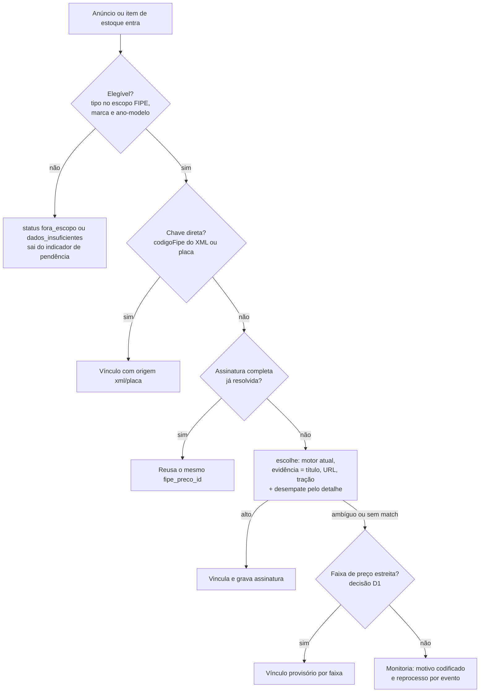

# FIPE × Anúncios: cobertura máxima e vínculo por assinatura — Plano de implementação

> **For agentic workers:** REQUIRED SUB-SKILL: Use superpowers:subagent-driven-development (recommended) or superpowers:executing-plans to implement this plan task-by-task. Steps use checkbox (`- [ ]`) syntax for tracking.

**Goal:** Reduzir ao mínimo os anúncios ativos de caminhão sem vínculo FIPE, sem aumentar vínculos errados, e garantir que todo veículo com a mesma "assinatura" (marca + família + modelo + ano-modelo + tração + emissão + cabine + câmbio) receba automaticamente o mesmo `fipe_preco_id`, passando por uma peneira única antes de entrar no estoque ou na monitoria.

**Architecture:** Primeiro medir (diagnóstico read-only e conjunto-ouro auditado), depois enriquecer a evidência (campos de detalhe que hoje são ignorados e atributos do catálogo FIPE materializados), depois introduzir uma tabela de assinaturas (`fipe_assinatura`) consultada antes do motor de pontuação existente (`escolhe`), que permanece intacto. O que não resolve vai para uma fila de monitoria com motivo codificado e política de reprocessamento por evento, no lugar do prazo fixo de 30 dias.

**Tech Stack:** Python 3.12+ (`unittest`, `mysql-connector-python`), MySQL/MariaDB da HostGator, PHP 8 (API), cron do cPanel. Sem dependências novas.

**Spec:** Não há documento de design separado. O contexto está na seção "Diagnóstico do que existe hoje" e as escolhas em aberto estão em "Decisões que precisam de você". Mapa de conexões FIPE × anúncios gerado com o graphify: `graphify-out/graph.html` (pasta `OperRadar-FIPE-Grafo` em Downloads).

## Global Constraints

- **Falso vínculo é pior que nenhum vínculo.** Os bugs de DAF, IVECO, série Scania e cabine (P0, 01/10/2026) vieram de aceitar candidato por ausência de contradição. Nenhuma tarefa deste plano pode relaxar um portão de `escolhe()` sem passar pelo conjunto-ouro (Task 2).
- **Vínculo manual nunca é sobrescrito.** `anuncio.fipe_vinculo_origem = 'manual'` é intocável por qualquer job; `anuncios_pendentes` já o exclui e isso deve continuar valendo.
- **Migrações idempotentes em Python**, no padrão de `fase2-fipe/migrar_fipe_mensal.py` (`existe_coluna`/`existe_indice` via `information_schema`), mais o `.sql` de referência. O banco ignora `CHECK`; validar status na aplicação.
- **Plano M da HostGator: limite de 25% de CPU por 90 s.** Todo job novo roda em lote com `LIMIT`, `flock` e pausa. Nada de varredura completa da tabela `anuncio` dentro de uma requisição web.
- **Nada escreve em produção antes de um dry-run aprovado.** Todo script que altera dados tem `--aplicar` desligado por padrão e imprime o diff (contagens e amostra) antes.
- **Sem segredos em arquivos do repositório.** Credenciais ficam em `~/.oper-radar.env`.
- **Rótulos de tela em português do Brasil.** "Saída observada não é venda" continua valendo em qualquer texto novo.
- **Testes**: `cd fase2-fipe && python -m unittest <modulo> -v`; suíte completa com `python -m unittest discover -s tests -p "test_*.py"` na raiz.

## Review Focus

1. **Anúncio de tipo fora do escopo da FIPE** (carreta, implemento, trator, colheitadeira). Hoje só `tipo = 'Caminhao'` entra na fila; esses anúncios não podem virar "sem match" nem receber FIPE por engano. Esperado: causa própria `fora_escopo_tipo`, fora do indicador de pendência.
2. **Assinatura parcial reutilizada como completa.** Anúncio sem eixo/cabine/emissão quando o catálogo varia nessa dimensão não pode herdar o `fipe_preco_id` de outro. Esperado: não reutiliza, vai para monitoria com o motivo da dimensão faltante.
3. **Curador troca o vínculo manual de um anúncio.** A assinatura correspondente vira `em_revisao`; os demais anúncios do grupo não mudam em silêncio e aparecem para revisão.
4. **Catálogo FIPE muda** (modelo novo de mesma família passa a variar o eixo, ou um modelo some). Assinaturas dependentes deixam de valer e são reavaliadas, nunca mantidas por inércia.
5. **Duas rodadas ao mesmo tempo** (cron pós-coleta e cron mensal). Esperado: `UNIQUE` na assinatura e `flock` impedem duplicação; a segunda rodada não regrava nem desfaz a primeira.

---

## Diagnóstico do que existe hoje

Fatos lidos no código (referências em `fase2-fipe/fipe_sync.py` salvo indicação):

| Achado | Onde | Consequência |
|---|---|---|
| O vínculo é feito **por anúncio**, sem memória do resultado. Dois anúncios idênticos repetem toda a pontuação e podem divergir. | `processa_anuncios` (linha 983), `escolhe` (767) | Não existe "mesmo ID de FIPE por assinatura". É o item central do pedido. |
| A fila só processa `tipo = 'Caminhao'`. | `anuncios_pendentes` (494), `fipe_fila_categorias.php` | Carretas, implementos e máquinas agrícolas (ex.: John Deere, Massey Ferguson, Facchini no painel) nunca recebem status. A FIPE só cobre caminhões e ônibus. |
| O texto usado no vínculo é título + URL + `modelo` + `tracao`. **`descricao`, `opcionais` e `carroceria` são coletados e ignorados.** | `texto_anuncio` (115) | Potência, câmbio, cabine e emissão escritos só na descrição não ajudam a desempatar. Maior ganho potencial de baixo risco. |
| Ambiguidade vira rejeição (eixo, emissão, cabine, câmbio, linha, `len(cands) > 8`). | `escolhe` | Decisão correta contra falso vínculo, mas aumenta o "fora da FIPE". Nunca se mediu quanto da rejeição é inofensiva (variantes com preço quase igual). |
| Anúncios `sem_match`, `ambiguo` e `sem_ano` só são retentados após **30 dias**. | `anuncios_pendentes` (510-511) | O detalhe que chega depois da primeira tentativa não reabre o caso; hoje isso depende de scripts avulsos `reabrir_fipe_*.py`. |
| O catálogo FIPE é só `marca` + `modelo` em texto livre; cada nome é re-interpretado a cada anúncio. | `schema_fipe_mysql.sql`, `modelos_da_marca` (522) | Não há como listar "quais dimensões variam neste modelo" nem achar lacunas de catálogo em lote. |
| O estoque XML já vincula por `codigoFipe` quando o arquivo traz o código; sem código, o item fica sem FIPE. | `minha_loja_xml.php:70-73,109`, `lib/xml_estoque.php:122` | "28 sem vínculo FIPE (todos vindos do XML)" (PRODUCAO.md, Release 2.4) são candidatos diretos à peneira. |
| Único número de partida documentado: **cobertura de 50,5% (5.956 de 11.798 caminhões ativos) em 01/10/2026** (`oper-radar-api/README.md:187`), ou seja, cerca de 5.800 caminhões sem FIPE. É anterior aos portões P0, que só endureceram a regra. A precisão (taxa de vínculo errado) nunca foi medida: "não se mediu cobertura em banco real" (`fase2-fipe/README.md`). | README | Antes de otimizar, é preciso o número atual de cobertura por causa e a taxa de erro. A Task 1 refaz o primeiro e a Task 2 cria o segundo. |
| Já existem: curadoria manual (`anuncio_detalhe.php` POST), sugestões (`anuncio_fipe_sugestao`), auditoria e fila por categoria (`fipe_fila_categorias.php`), grupo de equivalência de mercado (`lib/equivalent_group.php`). | vários | A monitoria e a curadoria existem; falta a camada de assinatura e os motivos codificados. |

### Fluxo alvo da peneira



## Decisões que precisam de você

Nenhuma tarefa abaixo depende de resposta imediata, exceto D1 (Task 8) e D3 (Task 9). Recomendações em negrito.

- **D1 — Vínculo provisório por faixa de preço.** Quando o motor não consegue escolher entre variantes (cabine, câmbio, eixo), mas todos os candidatos têm preço FIPE dentro de uma faixa estreita (proposta: dispersão ≤ 5% entre mínimo e máximo), a ambiguidade é inofensiva para comparar preços. **Recomendado: aceitar, gravando `confianca = 'provisorio'`, com selo "FIPE aproximada" na tela e fora da mediana oficial de FIPE até ser confirmado.** Risco: alguém ler o provisório como exato. Alternativa: não ter provisório e manter tudo em monitoria.
- **D2 — Escopo de tipos.** A FIPE não tem tabela para trator, colheitadeira, carreta e implemento. **Recomendado: classificar como `fora_escopo_tipo` e tirar do indicador de "fora da FIPE"**, em vez de tentar vincular. Máquinas agrícolas ganhariam outra referência (fora deste plano).
- **D3 — Onde a peneira roda na entrada do estoque.** **Recomendado: cron a cada 30 min com `flock` (assíncrono, ≤30 min até o vínculo), mais a chave direta `codigoFipe` que já é imediata.** Alternativa: portar o extrator para PHP para vincular no ato do import; exige testes compartilhados para os dois lados não divergirem e é bem mais caro.
- **D4 — Meta.** **Recomendado: fechar a meta só depois da Task 1**, com a regra "recuperar pelo menos 80% das perdas classificadas como recuperáveis (ambiguidade de eixo/cabine/câmbio/emissão, nunca processado, ano ausente no cache) com precisão auditada igual ou maior que a de hoje".

---

### Task 1: Diagnóstico de cobertura (somente leitura)

**Files:**
- Create: `fase2-fipe/diagnostico_cobertura.py`
- Create: `fase2-fipe/test_diagnostico_cobertura.py`
- Create (saída, depois de rodar na VPS): `docs/oper-radar-fipe/DIAGNOSTICO_COBERTURA_2026-10.md`

**Interfaces:**
- Produces: `classifica_causa(linha: dict) -> str`, uma das `CAUSAS`; `relatorio_markdown(total: int, por_causa: dict, por_marca: list, motivos: list, com_detalhe_nao_vinculados: int) -> str`.

- [ ] **Step 1: Escrever o teste que falha**

```python
# fase2-fipe/test_diagnostico_cobertura.py
import sys
import unittest
from pathlib import Path

sys.path.insert(0, str(Path(__file__).resolve().parent))
from diagnostico_cobertura import CAUSAS, classifica_causa, relatorio_markdown


def linha(**kw):
    base = {"tipo": "Caminhao", "marca": "SCANIA", "ano_inicial": 2020, "ano_final": 2020,
            "fipe_preco_id": None, "fipe_vinculo_origem": "automatico",
            "fipe_match_confianca": None, "fipe_match_status": None, "fipe_match_motivo": None}
    base.update(kw)
    return base


class ClassificaCausaTest(unittest.TestCase):
    def test_vinculados(self):
        self.assertEqual("vinculado_alto", classifica_causa(linha(fipe_preco_id=1, fipe_match_confianca="alto")))
        self.assertEqual("vinculado_medio", classifica_causa(linha(fipe_preco_id=1, fipe_match_confianca="medio")))
        self.assertEqual("vinculado_manual", classifica_causa(linha(fipe_preco_id=1, fipe_vinculo_origem="manual")))

    def test_fora_do_escopo_nao_e_pendencia(self):
        self.assertEqual("fora_escopo_tipo", classifica_causa(linha(tipo="Carreta")))
        self.assertEqual("fora_escopo_tipo", classifica_causa(linha(tipo="Maquinas")))

    def test_dados_insuficientes(self):
        self.assertEqual("sem_marca", classifica_causa(linha(marca=None)))
        self.assertEqual("sem_ano", classifica_causa(linha(ano_inicial=None, ano_final=None)))

    def test_motivos_do_motor(self):
        casos = {
            "ambiguo eixo (4X2/6X2)": "ambiguo_eixo",
            "sem match eixo 6X4": "ambiguo_eixo",
            "conflito eixo (4X2/6X4)": "ambiguo_eixo",
            "ambiguo emissao (E5/E6)": "ambiguo_emissao",
            "sem match emissao E6": "ambiguo_emissao",
            "ambiguo cabine (SEM TAG/SPACE)": "ambiguo_cabine",
            "ambiguo cambio (MANUAL/AUTOMATIZADO)": "ambiguo_cambio",
            "ambiguo serie/geracao (2 candidatos)": "ambiguo_linha_serie",
            "ambiguo linha (ATEGO/ATRON)": "ambiguo_linha_serie",
            "ambiguo 3 candidatos": "ambiguo_outros",
        }
        for motivo, esperado in casos.items():
            status = "ambiguo" if motivo.startswith(("ambiguo", "conflito")) else "sem_match"
            with self.subTest(motivo=motivo):
                self.assertEqual(esperado, classifica_causa(
                    linha(fipe_match_status=status, fipe_match_motivo=motivo)))

    def test_estados_sem_motivo(self):
        self.assertEqual("nunca_processado", classifica_causa(linha()))
        self.assertEqual("erro_api", classifica_causa(linha(fipe_match_status="erro_api")))
        self.assertEqual("ano_ausente_no_cache", classifica_causa(linha(fipe_match_status="sem_ano")))
        self.assertEqual("sem_candidato", classifica_causa(
            linha(fipe_match_status="sem_match", fipe_match_motivo="sem match")))

    def test_toda_causa_retornada_esta_declarada(self):
        self.assertIn("outros", CAUSAS)
        self.assertEqual("outros", classifica_causa(linha(fipe_match_status="reprocessar_x")))


class RelatorioTest(unittest.TestCase):
    def test_relatorio_traz_percentuais_e_ranking(self):
        md = relatorio_markdown(
            total=10, por_causa={"vinculado_alto": 6, "ambiguo_cabine": 3, "sem_candidato": 1},
            por_marca=[("DAF", 4, 1)], motivos=[("ambiguo cabine (SEM TAG/SPACE)", 3)],
            com_detalhe_nao_vinculados=2)
        self.assertIn("60,0%", md)
        self.assertIn("DAF", md)
        self.assertIn("ambiguo cabine", md)
        self.assertIn("2", md)


if __name__ == "__main__":
    unittest.main()
```

- [ ] **Step 2: Rodar e ver falhar**

Run: `cd fase2-fipe && python -m unittest test_diagnostico_cobertura -v`
Expected: FAIL com `ModuleNotFoundError: No module named 'diagnostico_cobertura'`.

- [ ] **Step 3: Implementar**

```python
# fase2-fipe/diagnostico_cobertura.py
"""Diagnostico SOMENTE LEITURA da cobertura FIPE x anuncios ativos.

Uso: python diagnostico_cobertura.py [--saida relatorio.md]
Credenciais pelo ambiente (OPER_RADAR_DB_*), como os demais jobs.
"""
import argparse
import os
from collections import Counter

CAUSAS = (
    "vinculado_alto", "vinculado_medio", "vinculado_manual",
    "fora_escopo_tipo", "sem_marca", "sem_ano", "nunca_processado", "erro_api",
    "ano_ausente_no_cache", "ambiguo_eixo", "ambiguo_emissao", "ambiguo_cabine",
    "ambiguo_cambio", "ambiguo_linha_serie", "ambiguo_outros", "sem_candidato", "outros",
)
RECUPERAVEIS = {"nunca_processado", "ano_ausente_no_cache", "ambiguo_eixo", "ambiguo_emissao",
                "ambiguo_cabine", "ambiguo_cambio", "ambiguo_outros", "erro_api"}


def classifica_causa(linha: dict) -> str:
    if linha.get("fipe_preco_id"):
        if linha.get("fipe_vinculo_origem") == "manual":
            return "vinculado_manual"
        return "vinculado_alto" if linha.get("fipe_match_confianca") == "alto" else "vinculado_medio"
    if (linha.get("tipo") or "").strip().lower() != "caminhao":
        return "fora_escopo_tipo"
    if not linha.get("marca"):
        return "sem_marca"
    if linha.get("ano_final") is None and linha.get("ano_inicial") is None:
        return "sem_ano"
    status = linha.get("fipe_match_status")
    motivo = (linha.get("fipe_match_motivo") or "").lower()
    if status is None:
        return "nunca_processado"
    if status == "erro_api":
        return "erro_api"
    if status == "sem_ano":
        return "ano_ausente_no_cache"
    if "eixo" in motivo:
        return "ambiguo_eixo"
    if "emissao" in motivo:
        return "ambiguo_emissao"
    if "cabine" in motivo:
        return "ambiguo_cabine"
    if "cambio" in motivo:
        return "ambiguo_cambio"
    if "serie" in motivo or "linha" in motivo or "geracao" in motivo:
        return "ambiguo_linha_serie"
    if status == "ambiguo":
        return "ambiguo_outros"
    if status == "sem_match":
        return "sem_candidato"
    return "outros"


def _pct(n, total):
    return f"{(100.0 * n / total):.1f}%".replace(".", ",") if total else "0,0%"


def relatorio_markdown(total, por_causa, por_marca, motivos, com_detalhe_nao_vinculados):
    linhas = ["# Diagnóstico de cobertura FIPE × anúncios ativos", "",
              f"Anúncios ativos analisados: **{total}**", "",
              "## Por causa", "", "| Causa | Anúncios | % do total | Recuperável |", "|---|---:|---:|:--:|"]
    for causa in CAUSAS:
        n = por_causa.get(causa, 0)
        if n:
            linhas.append(f"| {causa} | {n} | {_pct(n, total)} | {'sim' if causa in RECUPERAVEIS else ''} |")
    recup = sum(por_causa.get(c, 0) for c in RECUPERAVEIS)
    linhas += ["", f"Perdas recuperáveis: **{recup}** ({_pct(recup, total)}).",
               f"Não vinculados que já têm descrição de detalhe (evidência hoje ignorada): **{com_detalhe_nao_vinculados}**.",
               "", "## Marcas com mais anúncios sem vínculo", "", "| Marca | Sem vínculo | Vinculados |", "|---|---:|---:|"]
    for marca, sem, vinc in por_marca:
        linhas.append(f"| {marca} | {sem} | {vinc} |")
    linhas += ["", "## Motivos mais frequentes do motor", "", "| Motivo | Anúncios |", "|---|---:|"]
    for motivo, n in motivos:
        linhas.append(f"| {motivo} | {n} |")
    return "\n".join(linhas) + "\n"


SQL = """
SELECT tipo, marca, ano_inicial, ano_final, fipe_preco_id, fipe_vinculo_origem,
       fipe_match_confianca, fipe_match_status, fipe_match_motivo,
       (descricao IS NOT NULL AND descricao <> '') AS tem_descricao
FROM anuncio WHERE status = 'ativo'
"""


def coleta(conn):
    cur = conn.cursor(dictionary=True)
    cur.execute(SQL)
    total = 0
    por_causa, motivos = Counter(), Counter()
    marcas = {}
    com_detalhe = 0
    for linha in cur:
        total += 1
        causa = classifica_causa(linha)
        por_causa[causa] += 1
        marca = linha.get("marca") or "(sem marca)"
        vinc, sem = marcas.get(marca, (0, 0))
        if causa.startswith("vinculado"):
            vinc += 1
        elif causa != "fora_escopo_tipo":
            sem += 1
            if linha.get("tem_descricao"):
                com_detalhe += 1
            if linha.get("fipe_match_motivo"):
                motivos[linha["fipe_match_motivo"]] += 1
        marcas[marca] = (vinc, sem)
    cur.close()
    ranking = sorted(((m, s, v) for m, (v, s) in marcas.items() if s), key=lambda x: -x[1])[:15]
    return total, dict(por_causa), ranking, motivos.most_common(30), com_detalhe


if __name__ == "__main__":
    import mysql.connector
    ap = argparse.ArgumentParser()
    ap.add_argument("--saida")
    ap.add_argument("--db-host", default=os.getenv("OPER_RADAR_DB_HOST", "localhost"))
    ap.add_argument("--db-user", default=os.getenv("OPER_RADAR_DB_USER"))
    ap.add_argument("--db-pass", default=os.getenv("OPER_RADAR_DB_PASS"))
    ap.add_argument("--db-name", default=os.getenv("OPER_RADAR_DB_NAME"))
    args = ap.parse_args()
    if not all((args.db_user, args.db_pass, args.db_name)):
        ap.error("credenciais OPER_RADAR_DB_* ausentes")
    conn = mysql.connector.connect(host=args.db_host, user=args.db_user, password=args.db_pass,
                                   database=args.db_name, charset="utf8mb4")
    try:
        md = relatorio_markdown(*coleta(conn))
    finally:
        conn.close()
    if args.saida:
        Path = __import__("pathlib").Path
        Path(args.saida).write_text(md, encoding="utf-8")
    print(md)
```

- [ ] **Step 4: Rodar e ver passar**

Run: `cd fase2-fipe && python -m unittest test_diagnostico_cobertura -v`
Expected: PASS (7 testes).

- [ ] **Step 5: Commit**

```bash
git add fase2-fipe/diagnostico_cobertura.py fase2-fipe/test_diagnostico_cobertura.py
git commit -m "feat(fipe): diagnóstico read-only de cobertura FIPE × anúncios por causa"
```

- [ ] **Step 6: Rodar na VPS (somente leitura) e guardar o número de partida**

```bash
cd /home1/pro93061/agenciaoper.com.br/oper-radar/fase2-fipe
set -a; . /home1/pro93061/.oper-radar.env; set +a
python3 diagnostico_cobertura.py --saida /home1/pro93061/diagnostico_cobertura_2026-10.md
```

Expected: relatório impresso com totais por causa. Copiar para `docs/oper-radar-fipe/DIAGNOSTICO_COBERTURA_2026-10.md` e commitar. **Este arquivo fecha D2 e D4.**

---

### Task 2: Conjunto-ouro e medição de precisão do motor atual

**Files:**
- Create: `fase2-fipe/exportar_conjunto_ouro.py`
- Create: `fase2-fipe/avaliar_conjunto_ouro.py`
- Create: `fase2-fipe/test_avaliar_conjunto_ouro.py`

**Interfaces:**
- Consumes: `fipe_sync.escolhe(conn, anuncio) -> (candidatos|None, confianca|motivo)`.
- Produces: `compara(esperado_modelo_id: int, resultado) -> str` ∈ {`acerto`, `erro`, `omitiu`}; `resumo(contagens: dict) -> dict` com `precisao`, `cobertura`.

O conjunto-ouro tem duas fontes: (a) vínculos **manuais** (verdade humana) e (b) amostra estratificada de ~150 vínculos automáticos `alto`, com uma coluna `auditor_ok` preenchida por uma pessoa. A precisão do motor é medida em (a) e (b); o recall em (a).

- [ ] **Step 1: Escrever o teste que falha**

```python
# fase2-fipe/test_avaliar_conjunto_ouro.py
import sys
import unittest
from pathlib import Path

sys.path.insert(0, str(Path(__file__).resolve().parent))
from avaliar_conjunto_ouro import compara, resumo


class AvaliacaoTest(unittest.TestCase):
    def test_compara(self):
        cand = [{"id": 7, "modelo_fipe": "R 440"}]
        self.assertEqual("acerto", compara(7, (cand, "alto")))
        self.assertEqual("erro", compara(8, (cand, "alto")))
        self.assertEqual("omitiu", compara(7, (None, "ambiguo eixo")))

    def test_candidato_multiplo_nao_e_acerto(self):
        cand = [{"id": 7}, {"id": 9}]
        self.assertEqual("omitiu", compara(7, (cand, "medio")))

    def test_resumo(self):
        r = resumo({"acerto": 90, "erro": 2, "omitiu": 8})
        self.assertAlmostEqual(90 / 92, r["precisao"])
        self.assertAlmostEqual(0.90, r["cobertura"])

    def test_resumo_sem_vinculos_nao_divide_por_zero(self):
        self.assertEqual(0.0, resumo({"omitiu": 5})["precisao"])


if __name__ == "__main__":
    unittest.main()
```

- [ ] **Step 2: Rodar e ver falhar**

Run: `cd fase2-fipe && python -m unittest test_avaliar_conjunto_ouro -v`
Expected: FAIL com `ModuleNotFoundError`.

- [ ] **Step 3: Implementar a avaliação**

```python
# fase2-fipe/avaliar_conjunto_ouro.py
"""Replay SOMENTE LEITURA do motor atual contra o conjunto-ouro.

Uso (na VPS): python avaliar_conjunto_ouro.py ouro.csv
CSV: anuncio_id, fipe_modelo_id_esperado  (colunas extras sao ignoradas)
"""
import csv
import os
import sys
from collections import Counter


def compara(esperado_modelo_id, resultado):
    cands, info = resultado
    if not cands or len(cands) != 1:
        return "omitiu"
    return "acerto" if int(cands[0]["id"]) == int(esperado_modelo_id) else "erro"


def resumo(c):
    vinculou = c.get("acerto", 0) + c.get("erro", 0)
    total = vinculou + c.get("omitiu", 0)
    return {
        "precisao": (c.get("acerto", 0) / vinculou) if vinculou else 0.0,
        "cobertura": (c.get("acerto", 0) / total) if total else 0.0,
        "total": total,
    }


if __name__ == "__main__":
    import mysql.connector
    from fipe_sync import escolhe
    conn = mysql.connector.connect(
        host=os.getenv("OPER_RADAR_DB_HOST", "localhost"), user=os.environ["OPER_RADAR_DB_USER"],
        password=os.environ["OPER_RADAR_DB_PASS"], database=os.environ["OPER_RADAR_DB_NAME"], charset="utf8mb4")
    contagens, erros = Counter(), []
    with open(sys.argv[1], newline="", encoding="utf-8") as f:
        for linha in csv.DictReader(f):
            cur = conn.cursor(dictionary=True)
            cur.execute("SELECT id, titulo, url, marca, modelo, tracao, ano_inicial, ano_final "
                        "FROM anuncio WHERE id=%s", (linha["anuncio_id"],))
            anuncio = cur.fetchone()
            cur.close()
            if not anuncio:
                continue
            res = compara(linha["fipe_modelo_id_esperado"], escolhe(conn, anuncio))
            contagens[res] += 1
            if res == "erro":
                erros.append((anuncio["id"], anuncio["titulo"]))
    conn.close()
    print(dict(contagens), resumo(contagens))
    for erro in erros[:50]:
        print("ERRO", erro)
```

- [ ] **Step 4: Rodar e ver passar**

Run: `cd fase2-fipe && python -m unittest test_avaliar_conjunto_ouro -v`
Expected: PASS (4 testes).

- [ ] **Step 5: Exportador do conjunto**

```python
# fase2-fipe/exportar_conjunto_ouro.py
"""Exporta (somente leitura) os vinculos manuais e uma amostra de 'alto' para auditoria humana."""
import csv
import os
import sys

SQL_MANUAL = """
SELECT a.id AS anuncio_id, a.titulo, a.marca, a.ano_final, fp.fipe_modelo_id AS fipe_modelo_id_esperado,
       'manual' AS origem, '' AS auditor_ok
FROM anuncio a JOIN fipe_preco fp ON fp.id = a.fipe_preco_id
WHERE a.status='ativo' AND a.fipe_vinculo_origem='manual'
"""
SQL_ALTO = """
SELECT a.id AS anuncio_id, a.titulo, a.marca, a.ano_final, fp.fipe_modelo_id AS fipe_modelo_id_esperado,
       'alto_amostra' AS origem, '' AS auditor_ok
FROM anuncio a JOIN fipe_preco fp ON fp.id = a.fipe_preco_id
WHERE a.status='ativo' AND a.fipe_match_confianca='alto' AND COALESCE(a.fipe_vinculo_origem,'automatico')='automatico'
ORDER BY RAND(42) LIMIT 150
"""

if __name__ == "__main__":
    import mysql.connector
    conn = mysql.connector.connect(
        host=os.getenv("OPER_RADAR_DB_HOST", "localhost"), user=os.environ["OPER_RADAR_DB_USER"],
        password=os.environ["OPER_RADAR_DB_PASS"], database=os.environ["OPER_RADAR_DB_NAME"], charset="utf8mb4")
    cur = conn.cursor(dictionary=True)
    saida = csv.writer(open(sys.argv[1], "w", newline="", encoding="utf-8"))
    cabecalho = False
    for sql in (SQL_MANUAL, SQL_ALTO):
        cur.execute(sql)
        for linha in cur.fetchall():
            if not cabecalho:
                saida.writerow(linha.keys())
                cabecalho = True
            saida.writerow(linha.values())
    conn.close()
```

- [ ] **Step 6: Commit**

```bash
git add fase2-fipe/exportar_conjunto_ouro.py fase2-fipe/avaliar_conjunto_ouro.py fase2-fipe/test_avaliar_conjunto_ouro.py
git commit -m "feat(fipe): conjunto-ouro e replay read-only para medir precisão do motor"
```

- [ ] **Step 7: Rodar na VPS e registrar o baseline**

```bash
cd /home1/pro93061/agenciaoper.com.br/oper-radar/fase2-fipe
set -a; . /home1/pro93061/.oper-radar.env; set +a
python3 exportar_conjunto_ouro.py /home1/pro93061/ouro.csv
# uma pessoa revisa as linhas 'alto_amostra' preenchendo auditor_ok (s/n); depois:
python3 avaliar_conjunto_ouro.py /home1/pro93061/ouro.csv
```

Expected: `{'acerto': N, 'erro': M, 'omitiu': K} {'precisao': ..., 'cobertura': ...}`. Registrar em `docs/oper-radar-fipe/BASELINE_PRECISAO_2026-10.md`. **Esse número é o piso: nenhuma tarefa seguinte pode reduzir a precisão abaixo dele.**

---

### Task 3: Evidência do detalhe como desempate (nunca como candidato)

**Files:**
- Create: `fase2-fipe/evidencia_detalhe.py`
- Create: `fase2-fipe/test_evidencia_detalhe.py`
- Modify: `fase2-fipe/fipe_sync.py:983-1006` (`processa_anuncios`) e `fase2-fipe/fipe_sync.py:494-497` (`anuncios_pendentes`, inclui `descricao`, `opcionais`, `carroceria` no SELECT)

**Interfaces:**
- Consumes: `emissao_no_texto`, `cabine_daf`, `cambio_daf`, `eixos`, `normaliza` de `fipe_sync`.
- Produces: `aumenta_com_detalhe(anuncio: dict) -> dict`, cópia do anúncio com tokens extras em `modelo`/`tracao` **somente** para dimensões ausentes em título/URL/modelo/tração e com exatamente um valor no detalhe.

Regra de segurança: descrições citam outros veículos ("aceito troca por Volvo FH 540"). Por isso o detalhe nunca fornece **família nem número do modelo**; só emissão, cabine, câmbio e eixo, e só quando o texto do detalhe aponta um único valor para a dimensão.

- [ ] **Step 1: Escrever o teste que falha**

```python
# fase2-fipe/test_evidencia_detalhe.py
import sys
import unittest
from pathlib import Path

sys.path.insert(0, str(Path(__file__).resolve().parent))
from fipe_sync import cabine_daf, eixo_do_anuncio, emissao_preferida, texto_anuncio
from evidencia_detalhe import aumenta_com_detalhe


def anuncio(**kw):
    base = {"titulo": "DAF XF 530 2022/2023", "url": "", "modelo": "", "tracao": "",
            "ano_inicial": 2022, "ano_final": 2023, "descricao": "", "opcionais": "", "carroceria": ""}
    base.update(kw)
    return base


class AumentaComDetalheTest(unittest.TestCase):
    def test_traz_eixo_e_cabine_do_detalhe_quando_titulo_nao_diz(self):
        a = anuncio(descricao="Cavalo mecânico 6x4, cabine Space Cab, Euro 6")
        r = aumenta_com_detalhe(a)
        self.assertEqual(("6X4", None), eixo_do_anuncio(r))
        self.assertEqual("E6", emissao_preferida(r)[0])
        self.assertEqual(cabine_daf("Space Cab"), cabine_daf(texto_anuncio(r)))

    def test_titulo_manda_sobre_o_detalhe(self):
        a = anuncio(titulo="DAF XF 530 6x2 2022/2023", descricao="aceito troca por 6x4")
        self.assertEqual(("6X2", None), eixo_do_anuncio(aumenta_com_detalhe(a)))

    def test_detalhe_com_valores_conflitantes_nao_entra(self):
        a = anuncio(descricao="6x2 ou 6x4 sob consulta")
        self.assertEqual((None, None), eixo_do_anuncio(aumenta_com_detalhe(a)))

    def test_detalhe_nunca_traz_numero_de_outro_modelo(self):
        a = anuncio(descricao="aceito troca por Volvo FH 540 e Scania R 450")
        r = aumenta_com_detalhe(a)
        self.assertNotIn("540", texto_anuncio(r))
        self.assertNotIn("450", texto_anuncio(r))

    def test_sem_detalhe_devolve_o_mesmo_conteudo(self):
        a = anuncio()
        self.assertEqual(texto_anuncio(a), texto_anuncio(aumenta_com_detalhe(a)))


if __name__ == "__main__":
    unittest.main()
```

- [ ] **Step 2: Rodar e ver falhar**

Run: `cd fase2-fipe && python -m unittest test_evidencia_detalhe -v`
Expected: FAIL com `ModuleNotFoundError: No module named 'evidencia_detalhe'`.

- [ ] **Step 3: Implementar**

```python
# fase2-fipe/evidencia_detalhe.py
"""Evidencia do detalhe do anuncio usada SOMENTE para desempate.

Nunca introduz familia/numero de modelo: a descricao livre cita outros veiculos.
"""
import re

from fipe_sync import cabine_daf, cambio_daf, eixo_do_anuncio, eixos, emissao_no_texto, normaliza

TOKEN_CABINE = {"SPACE": "SPACE CAB", "SUPER SPACE": "SUPER SPACE CAB", "DAY": "DAY CAB", "SLEEPER": "SLEEPER CAB"}


def _texto_detalhe(anuncio):
    partes = (anuncio.get("descricao"), anuncio.get("opcionais"), anuncio.get("carroceria"))
    return " ".join(str(p) for p in partes if p)[:2000]


def _valor_unico(valores):
    valores = {v for v in valores if v}
    return next(iter(valores)) if len(valores) == 1 else None


def _por_trecho(texto, extrator):
    # Divide em frases para que "6x2 ou 6x4" gere DOIS valores e nao um achado arbitrario.
    return {extrator(trecho) for trecho in re.split(r"[.;\n,/]|\bou\b", texto, flags=re.IGNORECASE)}


def aumenta_com_detalhe(anuncio):
    detalhe = normaliza(_texto_detalhe(anuncio))
    if not detalhe.strip():
        return anuncio
    resultado = dict(anuncio)

    if eixo_do_anuncio(anuncio) == (None, None):
        eixo = _valor_unico(_por_trecho(detalhe, eixos))
        if eixo:
            resultado["tracao"] = f"{anuncio.get('tracao') or ''} {eixo}".strip()

    extras = []
    base = " ".join(str(anuncio.get(c) or "") for c in ("titulo", "url", "modelo", "tracao"))
    if not emissao_no_texto(base):
        emissao = _valor_unico(_por_trecho(detalhe, emissao_no_texto))
        if emissao:
            extras.append("EURO 6" if emissao == "E6" else "EURO 5")
    if not cabine_daf(base):
        cabine = _valor_unico(_por_trecho(detalhe, cabine_daf))
        if cabine:
            extras.append(TOKEN_CABINE.get(cabine, cabine))
    if not cambio_daf(base):
        cambio = _valor_unico(_por_trecho(detalhe, cambio_daf))
        if cambio:
            extras.append(cambio)
    if extras:
        resultado["modelo"] = f"{anuncio.get('modelo') or ''} {' '.join(extras)}".strip()
    return resultado
```

- [ ] **Step 4: Rodar e ver passar**

Run: `cd fase2-fipe && python -m unittest test_evidencia_detalhe -v`
Expected: PASS (5 testes). Se `cabine_daf`/`cambio_daf` devolverem valores com formato diferente de `TOKEN_CABINE`, ajustar o mapa **no teste primeiro** (o teste compara o resultado de `cabine_daf` aplicado ao texto final).

- [ ] **Step 5: Ligar ao `processa_anuncios` atrás de flag, desligada por padrão**

Em `fase2-fipe/fipe_sync.py`, no `SELECT` de `anuncios_pendentes`, incluir `descricao, opcionais, carroceria`. Em `processa_anuncios`, trocar `cands, info = escolhe(conn, a)` por:

```python
            usa_detalhe = os.getenv("FIPE_USA_DETALHE", "0") == "1"
            if usa_detalhe:
                from evidencia_detalhe import aumenta_com_detalhe
                a_motor = aumenta_com_detalhe(a)
            else:
                a_motor = a
            cands, info = escolhe(conn, a_motor)
```

- [ ] **Step 6: Gate de precisão com o conjunto-ouro (decide se a flag liga)**

```bash
cd /home1/pro93061/agenciaoper.com.br/oper-radar/fase2-fipe
set -a; . /home1/pro93061/.oper-radar.env; set +a
python3 avaliar_conjunto_ouro.py /home1/pro93061/ouro.csv            # flag desligada
FIPE_USA_DETALHE=1 python3 avaliar_conjunto_ouro.py /home1/pro93061/ouro.csv   # flag ligada
```

Para a avaliação com flag, `avaliar_conjunto_ouro.py` deve aplicar `aumenta_com_detalhe` antes de `escolhe` quando `FIPE_USA_DETALHE=1` (mesmo trecho do Step 5). **Só liga em produção se a precisão não cair e a cobertura subir.** Resultado registrado em `docs/oper-radar-fipe/BASELINE_PRECISAO_2026-10.md`.

- [ ] **Step 7: Rodar a suíte de matching existente e commitar**

Run: `cd fase2-fipe && python -m unittest test_fipe_sync test_evidencia_detalhe -v`
Expected: PASS (80 do matching + 5 novos).

```bash
git add fase2-fipe/evidencia_detalhe.py fase2-fipe/test_evidencia_detalhe.py fase2-fipe/fipe_sync.py
git commit -m "feat(fipe): evidência do detalhe como desempate, atrás de FIPE_USA_DETALHE"
```

---

### Task 4: Atributos estruturados do catálogo FIPE

**Files:**
- Create: `fase2-fipe/catalogo_atributos.py`
- Create: `fase2-fipe/test_catalogo_atributos.py`
- Create: `fase2-fipe/migrar_fipe_assinatura.py` (criado aqui com a tabela de atributos; a de assinatura entra na Task 5)
- Create: `fase2-fipe/migracao_fipe_assinatura_mysql.sql` (referência)

**Interfaces:**
- Produces: `atributos_do_modelo_fipe(marca_fipe: str, modelo_fipe: str) -> dict` com chaves `familia, numero, serie, geracao, eixo, emissao, cabine, cambio`; `dims_que_variam(linhas: list[dict]) -> tuple[str, ...]`; `materializa_catalogo(conn) -> int`.

O catálogo fica parseado uma vez por modelo FIPE. Com isso dá para perguntar "dentro de (marca, família, número), em quais dimensões os modelos diferem?". Só essas dimensões precisam estar conhecidas para reutilizar um vínculo com segurança.

- [ ] **Step 1: Escrever o teste que falha**

```python
# fase2-fipe/test_catalogo_atributos.py
import sys
import unittest
from pathlib import Path

sys.path.insert(0, str(Path(__file__).resolve().parent))
from catalogo_atributos import atributos_do_modelo_fipe, dims_que_variam


class CatalogoAtributosTest(unittest.TestCase):
    def test_extrai_dimensoes_do_nome_fipe(self):
        a = atributos_do_modelo_fipe("DAF", "XF FTT 530 6x4 Space Cab (E6)")
        self.assertEqual("XF", a["familia"])
        self.assertEqual("6X4", a["eixo"])
        self.assertEqual("E6", a["emissao"])
        self.assertIsNotNone(a["cabine"])

    def test_dimensao_ausente_vira_none(self):
        a = atributos_do_modelo_fipe("SCANIA", "R 440 A 6x2")
        self.assertIsNone(a["emissao"])
        self.assertIsNone(a["cabine"])

    def test_dims_que_variam(self):
        linhas = [{"eixo": "4X2", "emissao": "E5", "cabine": None},
                  {"eixo": "6X2", "emissao": "E5", "cabine": None}]
        self.assertEqual(("eixo",), dims_que_variam(linhas))

    def test_dim_ausente_em_todos_nao_varia(self):
        self.assertEqual((), dims_que_variam([{"eixo": None}, {"eixo": None}]))

    def test_none_junto_com_valor_conta_como_variacao(self):
        # "XF FTT530 6x4" ao lado de "XF FTT530 6x4 Space Cab": o anuncio precisa dizer a cabine.
        linhas = [{"cabine": None}, {"cabine": "SPACE"}]
        self.assertEqual(("cabine",), dims_que_variam(linhas))


if __name__ == "__main__":
    unittest.main()
```

- [ ] **Step 2: Rodar e ver falhar**

Run: `cd fase2-fipe && python -m unittest test_catalogo_atributos -v`
Expected: FAIL com `ModuleNotFoundError`.

- [ ] **Step 3: Implementar**

```python
# fase2-fipe/catalogo_atributos.py
"""Atributos estruturados dos modelos do catalogo FIPE (parseados uma vez)."""
from fipe_sync import (
    cabine_daf, cambio_daf, eixos, emissao_no_texto, familia_comercial, geracao_daf,
    numero_modelo, serie,
)

DIMS = ("serie", "geracao", "eixo", "emissao", "cabine", "cambio")


def atributos_do_modelo_fipe(marca_fipe, modelo_fipe):
    return {
        "familia": familia_comercial(modelo_fipe),
        "numero": numero_modelo(modelo_fipe),
        "serie": serie(modelo_fipe),
        "geracao": geracao_daf(modelo_fipe, nome_fipe=True),
        "eixo": eixos(modelo_fipe),
        "emissao": emissao_no_texto(modelo_fipe),
        "cabine": cabine_daf(modelo_fipe),
        "cambio": cambio_daf(modelo_fipe),
    }


def dims_que_variam(linhas):
    """Dimensoes em que os modelos do grupo diferem (None junto de valor tambem e variacao)."""
    variam = []
    for dim in DIMS:
        valores = {linha.get(dim) for linha in linhas}
        if len(valores) > 1:
            variam.append(dim)
    return tuple(variam)


def materializa_catalogo(conn):
    """Preenche fipe_modelo_atributo para todo modelo FIPE. Idempotente (REPLACE por PK)."""
    cur = conn.cursor(dictionary=True)
    cur.execute("SELECT id, marca_fipe, modelo_fipe FROM fipe_modelo")
    modelos = cur.fetchall()
    cur.close()
    gravar = conn.cursor()
    for m in modelos:
        a = atributos_do_modelo_fipe(m["marca_fipe"], m["modelo_fipe"])
        gravar.execute(
            "REPLACE INTO fipe_modelo_atributo "
            "(fipe_modelo_id, marca_fipe, familia, numero, serie, geracao, eixo, emissao, cabine, cambio) "
            "VALUES (%s,%s,%s,%s,%s,%s,%s,%s,%s,%s)",
            (m["id"], m["marca_fipe"], a["familia"], a["numero"], a["serie"], a["geracao"],
             a["eixo"], a["emissao"], a["cabine"], a["cambio"]))
    conn.commit()
    gravar.close()
    return len(modelos)
```

- [ ] **Step 4: Rodar e ver passar**

Run: `cd fase2-fipe && python -m unittest test_catalogo_atributos -v`
Expected: PASS (5 testes).

- [ ] **Step 5: Migração idempotente da tabela de atributos**

```python
# fase2-fipe/migrar_fipe_assinatura.py
"""Migra de forma idempotente as tabelas do vinculo por assinatura (padrao de migrar_fipe_mensal.py)."""
import argparse
import os

import mysql.connector


def existe_tabela(conn, tabela):
    cur = conn.cursor()
    cur.execute("SELECT COUNT(*) FROM information_schema.TABLES "
                "WHERE TABLE_SCHEMA=DATABASE() AND TABLE_NAME=%s", (tabela,))
    existe = cur.fetchone()[0] > 0
    cur.close()
    return existe


def existe_coluna(conn, tabela, coluna):
    cur = conn.cursor()
    cur.execute("SELECT COUNT(*) FROM information_schema.COLUMNS "
                "WHERE TABLE_SCHEMA=DATABASE() AND TABLE_NAME=%s AND COLUMN_NAME=%s", (tabela, coluna))
    existe = cur.fetchone()[0] > 0
    cur.close()
    return existe


TABELA_ATRIBUTO = """
CREATE TABLE fipe_modelo_atributo (
    fipe_modelo_id INT NOT NULL PRIMARY KEY,
    marca_fipe     VARCHAR(80) NOT NULL,
    familia        VARCHAR(40) NULL,
    numero         VARCHAR(16) NULL,
    serie          VARCHAR(8)  NULL,
    geracao        VARCHAR(12) NULL,
    eixo           VARCHAR(4)  NULL,
    emissao        VARCHAR(2)  NULL,
    cabine         VARCHAR(24) NULL,
    cambio         VARCHAR(24) NULL,
    KEY idx_fma_grupo (marca_fipe, familia, numero),
    CONSTRAINT fk_fma_modelo FOREIGN KEY (fipe_modelo_id) REFERENCES fipe_modelo(id)
) ENGINE=InnoDB DEFAULT CHARSET=utf8mb4
"""


def migrar(conn):
    if not existe_tabela(conn, "fipe_modelo_atributo"):
        cur = conn.cursor()
        cur.execute(TABELA_ATRIBUTO)
        cur.close()
        print("Tabela fipe_modelo_atributo: criada")
    else:
        print("Tabela fipe_modelo_atributo: ja existe")
    conn.commit()


if __name__ == "__main__":
    ap = argparse.ArgumentParser()
    ap.add_argument("--db-host", default=os.getenv("OPER_RADAR_DB_HOST", "localhost"))
    ap.add_argument("--db-user", default=os.getenv("OPER_RADAR_DB_USER"))
    ap.add_argument("--db-pass", default=os.getenv("OPER_RADAR_DB_PASS"))
    ap.add_argument("--db-name", default=os.getenv("OPER_RADAR_DB_NAME"))
    args = ap.parse_args()
    if not all((args.db_user, args.db_pass, args.db_name)):
        ap.error("credenciais OPER_RADAR_DB_* ausentes")
    conn = mysql.connector.connect(host=args.db_host, user=args.db_user, password=args.db_pass,
                                   database=args.db_name, charset="utf8mb4")
    try:
        migrar(conn)
        print("Migracao FIPE assinatura: OK")
    finally:
        conn.close()
```

Replicar o mesmo `CREATE TABLE` em `fase2-fipe/migracao_fipe_assinatura_mysql.sql` como referência de formato (com o aviso de não idempotente que `migracao_detalhe_anuncio_mysql.sql` já usa).

- [ ] **Step 6: Commit**

```bash
git add fase2-fipe/catalogo_atributos.py fase2-fipe/test_catalogo_atributos.py fase2-fipe/migrar_fipe_assinatura.py fase2-fipe/migracao_fipe_assinatura_mysql.sql
git commit -m "feat(fipe): atributos estruturados do catálogo e migração fipe_modelo_atributo"
```

- [ ] **Step 7: Rodar na VPS, popular e listar lacunas de catálogo**

```bash
python3 migrar_fipe_assinatura.py
python3 -c "import os,mysql.connector as m; from catalogo_atributos import materializa_catalogo; c=m.connect(host=os.getenv('OPER_RADAR_DB_HOST','localhost'),user=os.environ['OPER_RADAR_DB_USER'],password=os.environ['OPER_RADAR_DB_PASS'],database=os.environ['OPER_RADAR_DB_NAME'],charset='utf8mb4'); print(materializa_catalogo(c),'modelos materializados')"
```

Expected: `N modelos materializados`. Conferir no relatório da Task 1 quantas marcas do radar não têm nenhum modelo em `fipe_modelo` (campo `sem_candidato` concentrado em uma marca indica lacuna de catálogo ou de `MAPA_MARCA`).

---

### Task 5: Assinatura canônica e tabela `fipe_assinatura`

**Files:**
- Create: `fase2-fipe/assinatura.py`
- Create: `fase2-fipe/test_assinatura.py`
- Modify: `fase2-fipe/migrar_fipe_assinatura.py` (adiciona `fipe_assinatura` e as colunas em `anuncio`)
- Modify: `fase2-fipe/migracao_fipe_assinatura_mysql.sql`

**Interfaces:**
- Consumes: `fipe_sync.{normaliza, familia_comercial, numero_modelo, serie, geracao_daf, eixo_do_anuncio, emissao_preferida, cabine_daf, cambio_daf, ano_modelo}`; `catalogo_atributos.{DIMS, dims_que_variam}`.
- Produces: `atributos_do_anuncio(anuncio) -> dict`; `Assinatura` (dataclass congelada: `hash, marca, familia, numero, ano_modelo, valores: dict, dims_discriminantes: tuple, completa: bool`); `monta_assinatura(attrs: dict, dims_discriminantes: tuple) -> Assinatura | None`.

A assinatura inclui **apenas as dimensões que variam no catálogo** para aquele (marca, família, número). Assim "6x4" no título de um modelo que só existe em 6x4 não separa grupos, e uma dimensão que passa a variar depois muda o hash (invalida o vínculo antigo em vez de reaproveitá-lo).

- [ ] **Step 1: Escrever o teste que falha**

```python
# fase2-fipe/test_assinatura.py
import sys
import unittest
from pathlib import Path

sys.path.insert(0, str(Path(__file__).resolve().parent))
from assinatura import atributos_do_anuncio, monta_assinatura


def attrs(**kw):
    base = {"marca": "SCANIA", "familia": "R", "numero": "440", "ano_modelo": 2020,
            "serie": None, "geracao": None, "eixo": None, "emissao": None, "cabine": None, "cambio": None}
    base.update(kw)
    return base


class AssinaturaTest(unittest.TestCase):
    def test_mesmos_atributos_mesmo_hash(self):
        a = monta_assinatura(attrs(eixo="6X2"), ("eixo",))
        b = monta_assinatura(attrs(eixo="6X2"), ("eixo",))
        self.assertEqual(a.hash, b.hash)
        self.assertTrue(a.completa)

    def test_dimensao_nao_discriminante_nao_separa_grupos(self):
        a = monta_assinatura(attrs(eixo="6X2", cabine="LEITO"), ("eixo",))
        b = monta_assinatura(attrs(eixo="6X2", cabine=None), ("eixo",))
        self.assertEqual(a.hash, b.hash)

    def test_dimensao_discriminante_ausente_deixa_incompleta(self):
        a = monta_assinatura(attrs(eixo=None), ("eixo",))
        self.assertFalse(a.completa)

    def test_discriminante_diferente_muda_hash(self):
        self.assertNotEqual(monta_assinatura(attrs(eixo="4X2"), ("eixo",)).hash,
                            monta_assinatura(attrs(eixo="6X2"), ("eixo",)).hash)

    def test_lista_de_dimensoes_faz_parte_da_identidade(self):
        # Se o catalogo passa a variar tambem o eixo, o hash antigo nao vale mais.
        self.assertNotEqual(monta_assinatura(attrs(eixo="6X2"), ()).hash,
                            monta_assinatura(attrs(eixo="6X2"), ("eixo",)).hash)

    def test_sem_base_minima_nao_gera_assinatura(self):
        self.assertIsNone(monta_assinatura(attrs(numero=None), ()))
        self.assertIsNone(monta_assinatura(attrs(ano_modelo=None), ()))
        self.assertIsNone(monta_assinatura(attrs(marca=None), ()))

    def test_ano_diferente_muda_hash(self):
        self.assertNotEqual(monta_assinatura(attrs(ano_modelo=2020), ()).hash,
                            monta_assinatura(attrs(ano_modelo=2021), ()).hash)


class AtributosDoAnuncioTest(unittest.TestCase):
    def test_le_dimensoes_do_titulo(self):
        a = atributos_do_anuncio({"titulo": "Scania R 440 A 6x2 2020/2020", "url": "", "marca": "SCANIA",
                                  "modelo": "", "tracao": "", "ano_inicial": 2020, "ano_final": 2020})
        self.assertEqual("SCANIA", a["marca"])
        self.assertEqual("440", a["numero"])
        self.assertEqual("6X2", a["eixo"])
        self.assertEqual(2020, a["ano_modelo"])

    def test_conflito_de_eixo_vira_none(self):
        a = atributos_do_anuncio({"titulo": "Scania R 440 4x2", "url": "", "marca": "SCANIA",
                                  "modelo": "", "tracao": "6x4", "ano_inicial": 2020, "ano_final": 2020})
        self.assertIsNone(a["eixo"])


if __name__ == "__main__":
    unittest.main()
```

- [ ] **Step 2: Rodar e ver falhar**

Run: `cd fase2-fipe && python -m unittest test_assinatura -v`
Expected: FAIL com `ModuleNotFoundError: No module named 'assinatura'`.

- [ ] **Step 3: Implementar**

```python
# fase2-fipe/assinatura.py
"""Assinatura canonica de um veiculo: base do 'mesmo veiculo, mesmo ID de FIPE'."""
import hashlib
from dataclasses import dataclass

from catalogo_atributos import DIMS
from fipe_sync import (
    ano_modelo, cabine_daf, cambio_daf, eixo_do_anuncio, emissao_preferida, familia_comercial,
    geracao_daf, normaliza, numero_modelo, serie, texto_anuncio,
)

MAPA_VALOR_NULO = "-"


@dataclass(frozen=True)
class Assinatura:
    hash: str
    marca: str
    familia: str
    numero: str
    ano_modelo: int
    valores: dict
    dims_discriminantes: tuple
    completa: bool


def atributos_do_anuncio(anuncio):
    texto = texto_anuncio(anuncio)
    eixo, conflito = eixo_do_anuncio(anuncio)
    emissao, _origem = emissao_preferida(anuncio)
    return {
        "marca": " ".join(normaliza(anuncio.get("marca", "")).split()) or None,
        "familia": familia_comercial(texto),
        "numero": numero_modelo(texto),
        "ano_modelo": ano_modelo(anuncio),
        "serie": serie(texto),
        "geracao": geracao_daf(texto),
        "eixo": None if conflito else eixo,
        "emissao": emissao,
        "cabine": cabine_daf(texto),
        "cambio": cambio_daf(texto),
    }


def monta_assinatura(attrs, dims_discriminantes):
    base = (attrs.get("marca"), attrs.get("familia"), attrs.get("numero"), attrs.get("ano_modelo"))
    if not all(base):
        return None
    dims = tuple(d for d in DIMS if d in dims_discriminantes)
    valores = {d: attrs.get(d) for d in dims}
    partes = [str(x) for x in base] + ["dims=" + ",".join(dims)] + [
        f"{d}={valores[d] or MAPA_VALOR_NULO}" for d in dims]
    return Assinatura(
        hash=hashlib.sha1("|".join(partes).encode("utf-8")).hexdigest(),
        marca=attrs["marca"], familia=attrs["familia"], numero=str(attrs["numero"]),
        ano_modelo=int(attrs["ano_modelo"]), valores=valores, dims_discriminantes=dims,
        completa=all(valores[d] for d in dims),
    )
```

- [ ] **Step 4: Rodar e ver passar**

Run: `cd fase2-fipe && python -m unittest test_assinatura -v`
Expected: PASS (9 testes).

- [ ] **Step 5: Estender a migração com `fipe_assinatura` e as colunas de `anuncio`**

Acrescentar a `migrar_fipe_assinatura.py`:

```python
TABELA_ASSINATURA = """
CREATE TABLE fipe_assinatura (
    id                  INT AUTO_INCREMENT PRIMARY KEY,
    hash_assinatura     CHAR(40) NOT NULL,
    marca               VARCHAR(40) NOT NULL,
    familia             VARCHAR(40) NOT NULL,
    numero              VARCHAR(16) NOT NULL,
    ano_modelo          SMALLINT NOT NULL,
    dims_discriminantes VARCHAR(80) NOT NULL,
    valores             VARCHAR(200) NOT NULL,
    fipe_preco_id       INT NOT NULL,
    origem              VARCHAR(12) NOT NULL,
    status              VARCHAR(12) NOT NULL DEFAULT 'ativa',
    evidencias          INT NOT NULL DEFAULT 1,
    criado_em           DATETIME NOT NULL DEFAULT CURRENT_TIMESTAMP,
    atualizado_em       DATETIME NOT NULL DEFAULT CURRENT_TIMESTAMP ON UPDATE CURRENT_TIMESTAMP,
    UNIQUE KEY uq_assinatura_hash (hash_assinatura),
    KEY idx_assinatura_preco (fipe_preco_id),
    CONSTRAINT fk_assinatura_preco FOREIGN KEY (fipe_preco_id) REFERENCES fipe_preco(id)
) ENGINE=InnoDB DEFAULT CHARSET=utf8mb4
"""
```

e dentro de `migrar(conn)` (depois da tabela de atributos):

```python
    if not existe_tabela(conn, "fipe_assinatura"):
        cur = conn.cursor()
        cur.execute(TABELA_ASSINATURA)
        cur.close()
        print("Tabela fipe_assinatura: criada")
    else:
        print("Tabela fipe_assinatura: ja existe")

    colunas = (
        ("fipe_assinatura_id", "INT NULL"),
        ("fipe_regra_versao", "SMALLINT NOT NULL DEFAULT 0"),
    )
    for nome, definicao in colunas:
        if not existe_coluna(conn, "anuncio", nome):
            cur = conn.cursor()
            cur.execute(f"ALTER TABLE anuncio ADD COLUMN {nome} {definicao}")
            cur.close()
            print(f"Coluna anuncio.{nome}: criada")
        else:
            print(f"Coluna anuncio.{nome}: ja existe")
```

`fipe_regra_versao` guarda com qual versão das regras o anúncio foi avaliado; quando a regra muda, os candidatos a reprocesso saem de uma consulta (Task 8), no lugar dos scripts `reabrir_fipe_*.py` avulsos.

- [ ] **Step 6: Commit**

```bash
git add fase2-fipe/assinatura.py fase2-fipe/test_assinatura.py fase2-fipe/migrar_fipe_assinatura.py fase2-fipe/migracao_fipe_assinatura_mysql.sql
git commit -m "feat(fipe): assinatura canônica e tabela fipe_assinatura"
```

---

### Task 6: Reuso por assinatura no processamento (mesmo veículo, mesmo ID)

**Files:**
- Create: `fase2-fipe/vinculo_por_assinatura.py`
- Create: `fase2-fipe/test_vinculo_por_assinatura.py`
- Modify: `fase2-fipe/fipe_sync.py` (`registra_resultado` ganha `assinatura_id=None`; `processa_anuncios` ganha o gate de reuso antes de `escolhe` e a gravação da assinatura depois de um vínculo `alto`)

**Interfaces:**
- Consumes: `assinatura.{atributos_do_anuncio, monta_assinatura}`; `catalogo_atributos.dims_que_variam`.
- Produces:
  - `dims_do_grupo(conn, marca: str, familia: str, numero: str) -> tuple[str, ...]`
  - `resolve_por_assinatura(conn, anuncio: dict) -> Reuso | None` com `Reuso(fipe_preco_id, assinatura_id, motivo)`
  - `grava_assinatura(conn, anuncio: dict, fipe_preco_id: int, origem: str) -> int | None`

Regras: só lê assinaturas `ativa` e `completa`. Só grava a partir de vínculo `alto` ou `manual`, nunca de `medio` nem `provisorio`. Em colisão de hash com `fipe_preco_id` diferente, a assinatura vai para `em_revisao` e deixa de propagar.

- [ ] **Step 1: Escrever o teste que falha** (com um `conn` falso que guarda as linhas em memória)

```python
# fase2-fipe/test_vinculo_por_assinatura.py
import sys
import unittest
from pathlib import Path

sys.path.insert(0, str(Path(__file__).resolve().parent))
import vinculo_por_assinatura as v


class FakeConn:
    """Conexao em memoria: so o necessario para provar as regras de reuso."""
    def __init__(self, dims=(), assinaturas=None):
        self.dims = dims
        self.assinaturas = assinaturas if assinaturas is not None else {}
        self.proximo = 1


ANUNCIO = {"titulo": "Scania R 440 A 6x2 2020/2020", "url": "", "marca": "SCANIA", "modelo": "",
           "tracao": "", "ano_inicial": 2020, "ano_final": 2020}


class ReusoTest(unittest.TestCase):
    def setUp(self):
        self._dims = v.dims_do_grupo
        self._busca = v._busca_assinatura
        self._grava = v._upsert_assinatura

    def tearDown(self):
        v.dims_do_grupo = self._dims
        v._busca_assinatura = self._busca
        v._upsert_assinatura = self._grava

    def test_reusa_o_mesmo_preco_para_o_mesmo_veiculo(self):
        v.dims_do_grupo = lambda conn, m, f, n: ("eixo",)
        v._busca_assinatura = lambda conn, h: {"id": 5, "fipe_preco_id": 321, "status": "ativa"}
        r = v.resolve_por_assinatura(None, ANUNCIO)
        self.assertEqual(321, r.fipe_preco_id)
        self.assertEqual(5, r.assinatura_id)

    def test_incompleta_nao_reusa(self):
        v.dims_do_grupo = lambda conn, m, f, n: ("eixo", "cabine")  # anuncio nao diz a cabine
        v._busca_assinatura = lambda conn, h: {"id": 5, "fipe_preco_id": 321, "status": "ativa"}
        self.assertIsNone(v.resolve_por_assinatura(None, ANUNCIO))

    def test_assinatura_em_revisao_nao_propaga(self):
        v.dims_do_grupo = lambda conn, m, f, n: ("eixo",)
        v._busca_assinatura = lambda conn, h: {"id": 5, "fipe_preco_id": 321, "status": "em_revisao"}
        self.assertIsNone(v.resolve_por_assinatura(None, ANUNCIO))

    def test_sem_assinatura_conhecida(self):
        v.dims_do_grupo = lambda conn, m, f, n: ("eixo",)
        v._busca_assinatura = lambda conn, h: None
        self.assertIsNone(v.resolve_por_assinatura(None, ANUNCIO))

    def test_so_grava_a_partir_de_alto_ou_manual(self):
        chamadas = []
        v.dims_do_grupo = lambda conn, m, f, n: ("eixo",)
        v._upsert_assinatura = lambda *a, **k: chamadas.append(a) or 9
        self.assertIsNone(v.grava_assinatura(None, ANUNCIO, 321, origem="medio"))
        self.assertIsNone(v.grava_assinatura(None, ANUNCIO, 321, origem="provisorio"))
        self.assertEqual(9, v.grava_assinatura(None, ANUNCIO, 321, origem="automatico"))
        self.assertEqual(9, v.grava_assinatura(None, ANUNCIO, 321, origem="manual"))
        self.assertEqual(2, len(chamadas))

    def test_incompleta_nao_grava(self):
        v.dims_do_grupo = lambda conn, m, f, n: ("eixo", "cabine")
        v._upsert_assinatura = lambda *a, **k: self.fail("nao deveria gravar assinatura incompleta")
        self.assertIsNone(v.grava_assinatura(None, ANUNCIO, 321, origem="automatico"))


class ConflitoTest(unittest.TestCase):
    def test_decide_status_ao_gravar_preco_diferente(self):
        self.assertEqual("em_revisao", v.status_apos_gravar(existente={"fipe_preco_id": 1, "origem": "automatico"},
                                                            novo_preco=2, novo_origem="automatico"))
        self.assertEqual("ativa", v.status_apos_gravar(existente={"fipe_preco_id": 1, "origem": "automatico"},
                                                       novo_preco=1, novo_origem="automatico"))

    def test_manual_substitui_automatica_sem_revisao(self):
        self.assertEqual("ativa", v.status_apos_gravar(existente={"fipe_preco_id": 1, "origem": "automatico"},
                                                       novo_preco=2, novo_origem="manual"))

    def test_manual_contra_manual_diferente_vai_para_revisao(self):
        self.assertEqual("em_revisao", v.status_apos_gravar(existente={"fipe_preco_id": 1, "origem": "manual"},
                                                            novo_preco=2, novo_origem="manual"))


if __name__ == "__main__":
    unittest.main()
```

- [ ] **Step 2: Rodar e ver falhar**

Run: `cd fase2-fipe && python -m unittest test_vinculo_por_assinatura -v`
Expected: FAIL com `ModuleNotFoundError`.

- [ ] **Step 3: Implementar**

```python
# fase2-fipe/vinculo_por_assinatura.py
"""Reuso do fipe_preco_id por assinatura canonica (mesmo veiculo, mesmo ID)."""
import json
from dataclasses import dataclass

from assinatura import atributos_do_anuncio, monta_assinatura
from catalogo_atributos import dims_que_variam

ORIGENS_QUE_GRAVAM = {"automatico", "manual", "xml"}


@dataclass(frozen=True)
class Reuso:
    fipe_preco_id: int
    assinatura_id: int
    motivo: str


def dims_do_grupo(conn, marca, familia, numero):
    cur = conn.cursor(dictionary=True)
    cur.execute(
        "SELECT eixo, emissao, cabine, cambio, serie, geracao FROM fipe_modelo_atributo "
        "WHERE familia=%s AND numero=%s AND UPPER(marca_fipe) LIKE %s", (familia, numero, f"%{marca.split()[0]}%"))
    linhas = cur.fetchall()
    cur.close()
    return dims_que_variam(linhas)


def _busca_assinatura(conn, hash_assinatura):
    cur = conn.cursor(dictionary=True)
    cur.execute("SELECT id, fipe_preco_id, status FROM fipe_assinatura WHERE hash_assinatura=%s", (hash_assinatura,))
    linha = cur.fetchone()
    cur.close()
    return linha


def status_apos_gravar(existente, novo_preco, novo_origem):
    if not existente or int(existente["fipe_preco_id"]) == int(novo_preco):
        return "ativa"
    if novo_origem == "manual" and existente.get("origem") != "manual":
        return "ativa"
    return "em_revisao"


def _upsert_assinatura(conn, ass, fipe_preco_id, origem):
    cur = conn.cursor(dictionary=True)
    cur.execute("SELECT id, fipe_preco_id, origem FROM fipe_assinatura WHERE hash_assinatura=%s FOR UPDATE",
                (ass.hash,))
    existente = cur.fetchone()
    status = status_apos_gravar(existente, fipe_preco_id, origem)
    valores = json.dumps(ass.valores, sort_keys=True)
    if existente is None:
        cur.execute(
            "INSERT INTO fipe_assinatura (hash_assinatura, marca, familia, numero, ano_modelo, "
            "dims_discriminantes, valores, fipe_preco_id, origem, status) VALUES (%s,%s,%s,%s,%s,%s,%s,%s,%s,%s)",
            (ass.hash, ass.marca, ass.familia, ass.numero, ass.ano_modelo,
             ",".join(ass.dims_discriminantes), valores, fipe_preco_id, origem, status))
        novo_id = cur.lastrowid
    else:
        preco = fipe_preco_id if status == "ativa" and origem == "manual" else existente["fipe_preco_id"]
        cur.execute(
            "UPDATE fipe_assinatura SET fipe_preco_id=%s, origem=%s, status=%s, evidencias=evidencias+1 WHERE id=%s",
            (preco, origem if status == "ativa" else existente["origem"], status, existente["id"]))
        novo_id = existente["id"]
    conn.commit()
    cur.close()
    return novo_id


def _assinatura_do_anuncio(conn, anuncio):
    attrs = atributos_do_anuncio(anuncio)
    if not all((attrs.get("marca"), attrs.get("familia"), attrs.get("numero"))):
        return None
    dims = dims_do_grupo(conn, attrs["marca"], attrs["familia"], attrs["numero"])
    return monta_assinatura(attrs, dims)


def resolve_por_assinatura(conn, anuncio):
    ass = _assinatura_do_anuncio(conn, anuncio)
    if ass is None or not ass.completa:
        return None
    achada = _busca_assinatura(conn, ass.hash)
    if not achada or achada["status"] != "ativa":
        return None
    return Reuso(int(achada["fipe_preco_id"]), int(achada["id"]), f"assinatura {ass.hash[:10]}")


def grava_assinatura(conn, anuncio, fipe_preco_id, origem):
    if origem not in ORIGENS_QUE_GRAVAM:
        return None
    ass = _assinatura_do_anuncio(conn, anuncio)
    if ass is None or not ass.completa:
        return None
    return _upsert_assinatura(conn, ass, fipe_preco_id, origem)
```

- [ ] **Step 4: Rodar e ver passar**

Run: `cd fase2-fipe && python -m unittest test_vinculo_por_assinatura -v`
Expected: PASS (9 testes).

- [ ] **Step 5: Ligar ao `processa_anuncios`**

Em `fase2-fipe/fipe_sync.py`:

`registra_resultado` passa a aceitar e gravar a assinatura:

```python
def registra_resultado(conn, anuncio_id, status, motivo, preco_id=None, confianca=None, assinatura_id=None):
    cur = conn.cursor()
    cur.execute("""
        UPDATE anuncio
        SET fipe_preco_id=%s, fipe_preco_automatico_id=%s,
            fipe_match_confianca=%s, fipe_match_confianca_automatico=%s,
            fipe_match_status=%s, fipe_match_status_automatico=%s,
            fipe_match_motivo=%s, fipe_match_motivo_automatico=%s,
            fipe_vinculo_origem='automatico', fipe_assinatura_id=%s,
            fipe_ultima_tentativa=NOW(), fipe_tentativas=fipe_tentativas+1
        WHERE id=%s
    """, (preco_id, preco_id, confianca, confianca, status, status,
          motivo[:160], motivo[:160], assinatura_id, anuncio_id))
    conn.commit()
    cur.close()
```

Em `processa_anuncios`, logo antes de `cands, info = escolhe(...)`:

```python
            from vinculo_por_assinatura import resolve_por_assinatura
            reuso = resolve_por_assinatura(conn, a)
            if reuso:
                registra_resultado(conn, a["id"], "vinculado", reuso.motivo,
                                   preco_id=reuso.fipe_preco_id, confianca="alto",
                                   assinatura_id=reuso.assinatura_id)
                vinculados += 1
                continue
```

e, logo depois do `registra_resultado(... "vinculado" ...)` do caminho normal:

```python
            if info == "alto":
                from vinculo_por_assinatura import grava_assinatura
                aid = grava_assinatura(conn, a, preco_id, origem="automatico")
                if aid:
                    registra_resultado(conn, a["id"], "vinculado",
                                       f"{escolhido['marca_fipe']} | {escolhido['modelo_fipe']}",
                                       preco_id=preco_id, confianca=info, assinatura_id=aid)
```

(a segunda chamada só acrescenta o `assinatura_id`; a primeira continua a gravação do vínculo para não mudar o comportamento existente).

- [ ] **Step 6: Suíte completa e commit**

Run: `cd fase2-fipe && python -m unittest test_fipe_sync test_assinatura test_vinculo_por_assinatura test_catalogo_atributos test_evidencia_detalhe test_diagnostico_cobertura test_avaliar_conjunto_ouro -v`
Expected: PASS, incluindo os 80 testes de matching sem alteração.

```bash
git add fase2-fipe/vinculo_por_assinatura.py fase2-fipe/test_vinculo_por_assinatura.py fase2-fipe/fipe_sync.py
git commit -m "feat(fipe): reuso do fipe_preco_id por assinatura no processamento"
```

---

### Task 7: Backfill por assinatura (dry-run primeiro)

**Files:**
- Create: `fase2-fipe/backfill_assinaturas.py`
- Create: `fase2-fipe/test_backfill_assinaturas.py`

**Interfaces:**
- Consumes: `vinculo_por_assinatura.{grava_assinatura, resolve_por_assinatura}`.
- Produces: `planeja(vinculados: list[dict], pendentes: list[dict], resolve_grava, resolve_reuso) -> dict` com `assinaturas_novas`, `conflitos`, `propagaveis`.

Duas passadas: (1) cria assinaturas a partir dos vínculos `alto`/`manual` já existentes; (2) para cada anúncio sem vínculo cuja assinatura ficou `ativa` e completa, aplica o mesmo `fipe_preco_id`. Padrão é dry-run; `--aplicar` escreve, em lotes de 500.

- [ ] **Step 1: Teste que falha**

```python
# fase2-fipe/test_backfill_assinaturas.py
import sys
import unittest
from pathlib import Path

sys.path.insert(0, str(Path(__file__).resolve().parent))
from backfill_assinaturas import planeja


class PlanejaTest(unittest.TestCase):
    def test_conta_assinaturas_novas_conflitos_e_propagaveis(self):
        vinculados = [{"id": 1, "p": 10}, {"id": 2, "p": 10}, {"id": 3, "p": 11}]
        pendentes = [{"id": 8}, {"id": 9}]
        grava = {1: "h1", 2: "h1", 3: None}          # 3 e incompleta
        reuso = {8: 10, 9: None}                       # so o 8 tem assinatura ativa
        r = planeja(vinculados, pendentes,
                    resolve_grava=lambda a: grava[a["id"]],
                    resolve_reuso=lambda a: reuso[a["id"]])
        self.assertEqual(1, r["assinaturas_novas"])
        self.assertEqual(1, r["incompletas"])
        self.assertEqual([8], [x["id"] for x in r["propagaveis"]])

    def test_dry_run_e_o_padrao(self):
        import backfill_assinaturas as b
        self.assertFalse(b.parse_args([]).aplicar)
        self.assertTrue(b.parse_args(["--aplicar"]).aplicar)


if __name__ == "__main__":
    unittest.main()
```

- [ ] **Step 2: Rodar e ver falhar**

Run: `cd fase2-fipe && python -m unittest test_backfill_assinaturas -v`
Expected: FAIL com `ModuleNotFoundError`.

- [ ] **Step 3: Implementar**

```python
# fase2-fipe/backfill_assinaturas.py
"""Backfill das assinaturas FIPE. Dry-run por padrao: so --aplicar escreve."""
import argparse
import os


def parse_args(argv=None):
    ap = argparse.ArgumentParser()
    ap.add_argument("--aplicar", action="store_true")
    ap.add_argument("--lote", type=int, default=500)
    ap.add_argument("--db-host", default=os.getenv("OPER_RADAR_DB_HOST", "localhost"))
    ap.add_argument("--db-user", default=os.getenv("OPER_RADAR_DB_USER"))
    ap.add_argument("--db-pass", default=os.getenv("OPER_RADAR_DB_PASS"))
    ap.add_argument("--db-name", default=os.getenv("OPER_RADAR_DB_NAME"))
    return ap.parse_args(argv)


def planeja(vinculados, pendentes, resolve_grava, resolve_reuso):
    hashes, incompletas = set(), 0
    for a in vinculados:
        h = resolve_grava(a)
        if h is None:
            incompletas += 1
        else:
            hashes.add(h)
    propagaveis = [a for a in pendentes if resolve_reuso(a) is not None]
    return {"assinaturas_novas": len(hashes), "incompletas": incompletas, "propagaveis": propagaveis}


if __name__ == "__main__":
    import mysql.connector
    from assinatura import atributos_do_anuncio, monta_assinatura
    from fipe_sync import registra_resultado
    from vinculo_por_assinatura import dims_do_grupo, grava_assinatura, resolve_por_assinatura

    args = parse_args()
    conn = mysql.connector.connect(host=args.db_host, user=args.db_user, password=args.db_pass,
                                   database=args.db_name, charset="utf8mb4")
    cur = conn.cursor(dictionary=True)
    cur.execute("""SELECT id, titulo, url, marca, modelo, tracao, ano_inicial, ano_final, fipe_preco_id AS p,
                          IF(fipe_vinculo_origem='manual','manual','automatico') AS origem
                   FROM anuncio WHERE status='ativo' AND fipe_preco_id IS NOT NULL
                     AND (fipe_vinculo_origem='manual' OR fipe_match_confianca='alto')""")
    vinculados = cur.fetchall()
    cur.execute("""SELECT id, titulo, url, marca, modelo, tracao, ano_inicial, ano_final
                   FROM anuncio WHERE status='ativo' AND tipo='Caminhao' AND fipe_preco_id IS NULL
                     AND COALESCE(fipe_vinculo_origem,'automatico') <> 'manual'""")
    pendentes = cur.fetchall()
    cur.close()

    def assinatura_hash(a):
        attrs = atributos_do_anuncio(a)
        if not all((attrs["marca"], attrs["familia"], attrs["numero"])):
            return None
        ass = monta_assinatura(attrs, dims_do_grupo(conn, attrs["marca"], attrs["familia"], attrs["numero"]))
        return ass.hash if ass and ass.completa else None

    if args.aplicar:
        for a in vinculados:                                   # passada 1: grava (manual primeiro)
            grava_assinatura(conn, a, a["p"], origem=a["origem"])
    plano = planeja(vinculados, pendentes, assinatura_hash,
                    lambda a: resolve_por_assinatura(conn, a))
    print({k: (len(v) if isinstance(v, list) else v) for k, v in plano.items()})
    for a in plano["propagaveis"][:20]:
        print("  propagaria:", a["id"], a["titulo"][:60])
    if args.aplicar:
        for i in range(0, len(plano["propagaveis"]), args.lote):  # passada 2: propaga em lotes
            for a in plano["propagaveis"][i:i + args.lote]:
                r = resolve_por_assinatura(conn, a)
                if r:
                    registra_resultado(conn, a["id"], "vinculado", r.motivo, preco_id=r.fipe_preco_id,
                                       confianca="alto", assinatura_id=r.assinatura_id)
    conn.close()
```

Nota: em dry-run a passada 1 não escreve, então `resolve_por_assinatura` só enxerga assinaturas já existentes; para ver a previsão completa, rodar o dry-run **depois** de uma execução com `--aplicar` apenas da passada 1 em um **banco de cópia**, ou aceitar a contagem conservadora do dry-run. Registrar a escolha no `BASELINE_PRECISAO_2026-10.md`.

- [ ] **Step 4: Rodar e ver passar**

Run: `cd fase2-fipe && python -m unittest test_backfill_assinaturas -v`
Expected: PASS (2 testes).

- [ ] **Step 5: Commit**

```bash
git add fase2-fipe/backfill_assinaturas.py fase2-fipe/test_backfill_assinaturas.py
git commit -m "feat(fipe): backfill de assinaturas com dry-run por padrão"
```

---

### Task 8: Monitoria com motivo codificado, reprocesso por evento e vínculo provisório (D1)

**Files:**
- Create: `fase2-fipe/monitoria.py`
- Create: `fase2-fipe/test_monitoria.py`
- Modify: `fase2-fipe/fipe_sync.py:494-519` (`anuncios_pendentes`: o critério de 30 dias passa a considerar eventos)

**Interfaces:**
- Produces: `REGRA_VERSAO: int`; `precisa_reprocessar(anuncio: dict, regra_versao_atual: int) -> bool`; `faixa_estreita(precos: list[float], limite: float = 0.05) -> bool`.

Hoje um anúncio `sem_match`/`ambiguo`/`sem_ano` só volta à fila após 30 dias. Passa a voltar quando: (a) o detalhe foi coletado depois da última tentativa; (b) `fipe_regra_versao` do anúncio é menor que `REGRA_VERSAO` (mudamos uma regra); (c) o catálogo FIPE foi atualizado depois da última tentativa. A faixa estreita só é usada **se D1 for aprovada**.

- [ ] **Step 1: Teste que falha**

```python
# fase2-fipe/test_monitoria.py
import sys
import unittest
from datetime import datetime, timedelta
from pathlib import Path

sys.path.insert(0, str(Path(__file__).resolve().parent))
from monitoria import faixa_estreita, precisa_reprocessar

AGORA = datetime(2026, 10, 22, 12, 0)


def anuncio(**kw):
    base = {"fipe_match_status": "ambiguo", "fipe_ultima_tentativa": AGORA - timedelta(days=2),
            "detalhe_coletado_em": None, "fipe_regra_versao": 3, "catalogo_atualizado_em": AGORA - timedelta(days=10)}
    base.update(kw)
    return base


class ReprocessoTest(unittest.TestCase):
    def test_detalhe_novo_reabre(self):
        a = anuncio(detalhe_coletado_em=AGORA - timedelta(hours=1))
        self.assertTrue(precisa_reprocessar(a, regra_versao_atual=3))

    def test_regra_nova_reabre(self):
        self.assertTrue(precisa_reprocessar(anuncio(fipe_regra_versao=2), regra_versao_atual=3))

    def test_catalogo_atualizado_reabre(self):
        a = anuncio(catalogo_atualizado_em=AGORA - timedelta(hours=1))
        self.assertTrue(precisa_reprocessar(a, regra_versao_atual=3))

    def test_nada_mudou_nao_reabre(self):
        self.assertFalse(precisa_reprocessar(anuncio(), regra_versao_atual=3))

    def test_status_vinculado_nunca_reabre_por_evento(self):
        a = anuncio(fipe_match_status="vinculado", detalhe_coletado_em=AGORA)
        self.assertFalse(precisa_reprocessar(a, regra_versao_atual=9))


class FaixaTest(unittest.TestCase):
    def test_faixa_estreita(self):
        self.assertTrue(faixa_estreita([500000, 510000, 520000]))
        self.assertFalse(faixa_estreita([500000, 560000]))

    def test_precisa_de_pelo_menos_dois_precos(self):
        self.assertFalse(faixa_estreita([500000]))
        self.assertFalse(faixa_estreita([]))

    def test_preco_zero_nao_quebra(self):
        self.assertFalse(faixa_estreita([0, 100]))


if __name__ == "__main__":
    unittest.main()
```

- [ ] **Step 2: Rodar e ver falhar**

Run: `cd fase2-fipe && python -m unittest test_monitoria -v`
Expected: FAIL com `ModuleNotFoundError`.

- [ ] **Step 3: Implementar**

```python
# fase2-fipe/monitoria.py
"""Politica de monitoria: quando um anuncio sem vinculo volta a ser avaliado."""
REGRA_VERSAO = 1  # incrementar a cada mudanca de regra de matching ou de evidencia


def precisa_reprocessar(anuncio, regra_versao_atual=REGRA_VERSAO):
    if anuncio.get("fipe_match_status") not in ("sem_match", "ambiguo", "sem_ano"):
        return False
    ultima = anuncio.get("fipe_ultima_tentativa")
    if ultima is None:
        return True
    detalhe = anuncio.get("detalhe_coletado_em")
    if detalhe and detalhe > ultima:
        return True
    catalogo = anuncio.get("catalogo_atualizado_em")
    if catalogo and catalogo > ultima:
        return True
    return int(anuncio.get("fipe_regra_versao") or 0) < regra_versao_atual


def faixa_estreita(precos, limite=0.05):
    validos = [p for p in precos if p and p > 0]
    if len(validos) < 2:
        return False
    return (max(validos) - min(validos)) / min(validos) <= limite
```

- [ ] **Step 4: Rodar e ver passar**

Run: `cd fase2-fipe && python -m unittest test_monitoria -v`
Expected: PASS (8 testes).

- [ ] **Step 5: Ajustar `anuncios_pendentes` aos eventos**

No `WHERE` de `anuncios_pendentes` (linhas 505-512), manter o critério de 30 dias como **teto de segurança** e acrescentar as três condições de evento:

```sql
OR (fipe_match_status IN ('sem_match','ambiguo','sem_ano')
    AND (detalhe_coletado_em > fipe_ultima_tentativa
         OR fipe_regra_versao < %(regra)s
         OR EXISTS (SELECT 1 FROM fipe_preco fp WHERE fp.atualizado_em > anuncio.fipe_ultima_tentativa LIMIT 1)))
```

e gravar `fipe_regra_versao = REGRA_VERSAO` em `registra_resultado`. A condição do catálogo usa a atualização mensal de preços como proxy do evento "catálogo mudou"; se medirmos custo alto na VPS, trocar por uma data única em `fipe_status`.

- [ ] **Step 6: Vínculo provisório por faixa (somente com D1 aprovada)**

No ramo `len(precos_validos) > 1` de `processa_anuncios` (hoje `ambiguo`), se `faixa_estreita([preço de cada candidato])` for verdadeiro e `FIPE_PROVISORIO=1`:

```python
            if len(precos_validos) > 1:
                valores = _precos_decimais(conn, [pid for _, pid in precos_validos])
                if os.getenv("FIPE_PROVISORIO", "0") == "1" and faixa_estreita(valores):
                    mediana_id = _id_da_mediana(precos_validos, valores)
                    registra_resultado(conn, a["id"], "vinculado",
                                       f"provisorio: {len(precos_validos)} variantes em faixa estreita",
                                       preco_id=mediana_id, confianca="provisorio")
                    continue
                ambiguos += 1
                registra_resultado(conn, a["id"], "ambiguo",
                                   f"ambiguo {len(precos_validos)} candidatos FIPE no ano-modelo {modelo_ano}")
                continue
```

`_precos_decimais` lê `SELECT id, preco FROM fipe_preco WHERE id IN (...)`; `_id_da_mediana` devolve o `fipe_preco_id` cujo preço é a mediana. `confianca = 'provisorio'` **não** grava assinatura (já garantido por `ORIGENS_QUE_GRAVAM`) e é excluído da mediana oficial na API (Task 10). A API e a tela precisam tratar `provisorio` antes de ligar `FIPE_PROVISORIO=1` em produção.

- [ ] **Step 7: Suíte e commit**

Run: `cd fase2-fipe && python -m unittest test_fipe_sync test_monitoria -v`
Expected: PASS.

```bash
git add fase2-fipe/monitoria.py fase2-fipe/test_monitoria.py fase2-fipe/fipe_sync.py
git commit -m "feat(fipe): monitoria com reprocesso por evento e vínculo provisório opcional"
```

---

### Task 9: Peneira na entrada: coleta pós-ciclo e estoque da Minha Loja (D3)

**Files:**
- Create: `fase2-fipe/peneira_estoque.py`
- Create: `fase2-fipe/test_peneira_estoque.py`
- Create: `fase2-fipe/instalar_cron_fipe_local.sh` (modelo: `instalar_cron_fipe_mensal.sh`)
- Modify: `fase2-fipe/executar_fipe_job.sh` (modo novo `peneira`, com `flock`)

**Interfaces:**
- Consumes: `vinculo_por_assinatura.resolve_por_assinatura`; tabela `meu_estoque` (`titulo, marca, modelo, ano, fipe_preco_id, origem`).
- Produces: `item_como_anuncio(item: dict) -> dict` (adapta uma linha de `meu_estoque` ao formato de anúncio do motor); `processa_estoque(conn, lote: int = 200) -> dict`.

Duas entradas, um só motor: (1) anúncios novos do mercado, vinculados pelo modo `local` do job FIPE a cada 30 min (já é só cache local, sem API); (2) itens do estoque que o XML trouxe **sem** `codigoFipe`, que hoje ficam sem vínculo. Itens com código continuam vinculados na hora por `minha_loja_xml.php`.

- [ ] **Step 1: Teste que falha**

```python
# fase2-fipe/test_peneira_estoque.py
import sys
import unittest
from pathlib import Path

sys.path.insert(0, str(Path(__file__).resolve().parent))
from peneira_estoque import item_como_anuncio


class AdaptadorTest(unittest.TestCase):
    def test_item_vira_anuncio_para_o_motor(self):
        a = item_como_anuncio({"id": 4, "titulo": "Scania R 440 6x2", "marca": "Scania", "modelo": "R 440",
                               "ano": "2020/2020", "url_anuncio": ""})
        self.assertEqual(2020, a["ano_final"])
        self.assertEqual("Scania R 440 6x2", a["titulo"])
        self.assertEqual("", a["tracao"])

    def test_ano_unico(self):
        self.assertEqual(2019, item_como_anuncio({"id": 1, "titulo": "x", "marca": "m", "modelo": "", "ano": 2019,
                                                  "url_anuncio": ""})["ano_final"])

    def test_ano_invalido_vira_none(self):
        self.assertIsNone(item_como_anuncio({"id": 1, "titulo": "x", "marca": "m", "modelo": "", "ano": "n/d",
                                             "url_anuncio": ""})["ano_final"])


if __name__ == "__main__":
    unittest.main()
```

- [ ] **Step 2: Rodar e ver falhar**

Run: `cd fase2-fipe && python -m unittest test_peneira_estoque -v`
Expected: FAIL com `ModuleNotFoundError`.

- [ ] **Step 3: Implementar**

```python
# fase2-fipe/peneira_estoque.py
"""Peneira do estoque (meu_estoque): itens sem FIPE passam pelo mesmo motor e pelas assinaturas."""
import re

from vinculo_por_assinatura import resolve_por_assinatura


def item_como_anuncio(item):
    anos = [int(x) for x in re.findall(r"\b(19\d{2}|20\d{2})\b", str(item.get("ano") or ""))]
    return {
        "id": item["id"], "titulo": item.get("titulo") or "", "url": item.get("url_anuncio") or "",
        "marca": item.get("marca") or "", "modelo": item.get("modelo") or "", "tracao": "",
        "ano_inicial": anos[0] if anos else None, "ano_final": anos[-1] if anos else None,
    }


def processa_estoque(conn, lote=200):
    cur = conn.cursor(dictionary=True)
    cur.execute("SELECT id, titulo, marca, modelo, ano, url_anuncio FROM meu_estoque "
                "WHERE fipe_preco_id IS NULL AND status <> 'vendido' ORDER BY id DESC LIMIT %s", (lote,))
    itens = cur.fetchall()
    resultado = {"avaliados": len(itens), "vinculados": 0, "pendentes": 0}
    gravar = conn.cursor()
    for item in itens:
        r = resolve_por_assinatura(conn, item_como_anuncio(item))
        if r:
            gravar.execute("UPDATE meu_estoque SET fipe_preco_id=%s WHERE id=%s AND fipe_preco_id IS NULL",
                           (r.fipe_preco_id, item["id"]))
            resultado["vinculados"] += 1
        else:
            resultado["pendentes"] += 1
    conn.commit()
    gravar.close()
    cur.close()
    return resultado
```

O item do estoque **só reutiliza** assinatura já resolvida (não cria vínculo novo pelo motor): o estoque é de um lojista específico e uma decisão automática errada aparece direto na comparação dele. Itens sem assinatura ativa ficam visíveis como "FIPE pendente" (Task 10) e entram na curadoria; quando o curador confirma, a Task 6 grava a assinatura e os próximos itens iguais já nascem vinculados.

- [ ] **Step 4: Rodar e ver passar**

Run: `cd fase2-fipe && python -m unittest test_peneira_estoque -v`
Expected: PASS (3 testes).

- [ ] **Step 5: Cron com `flock`, no padrão do job de detalhe**

`fase2-fipe/instalar_cron_fipe_local.sh`: ler `instalar_cron_fipe_mensal.sh` e replicar a estrutura de marcadores (`# OPER_RADAR_FIPE_LOCAL_INICIO` / `_FIM`) e o teste de idempotência. A linha instalada:

```
*/30 * * * * flock -n /home1/pro93061/logs/fipe-local.lock -c 'set -a; . /home1/pro93061/.oper-radar.env; set +a; cd /home1/pro93061/agenciaoper.com.br/oper-radar/fase2-fipe && bash executar_fipe_job.sh local && python3 -c "import os,mysql.connector as m; from peneira_estoque import processa_estoque; c=m.connect(host=os.getenv(\"OPER_RADAR_DB_HOST\",\"localhost\"),user=os.environ[\"OPER_RADAR_DB_USER\"],password=os.environ[\"OPER_RADAR_DB_PASS\"],database=os.environ[\"OPER_RADAR_DB_NAME\"],charset=\"utf8mb4\"); print(processa_estoque(c))"' >> /home1/pro93061/logs/fipe-local.log 2>&1
```

- [ ] **Step 6: Commit**

```bash
git add fase2-fipe/peneira_estoque.py fase2-fipe/test_peneira_estoque.py fase2-fipe/instalar_cron_fipe_local.sh fase2-fipe/executar_fipe_job.sh
git commit -m "feat(fipe): peneira pós-coleta e do estoque da Minha Loja"
```

---

### Task 10: Sincronizar a curadoria manual com as assinaturas, e indicadores

**Files:**
- Create: `fase2-fipe/sincroniza_curadoria.py`
- Create: `fase2-fipe/test_sincroniza_curadoria.py`
- Modify: `monitoramento/verificar_saude.py` (seção de cobertura FIPE por causa)
- Modify: `oper-radar-api/fipe_status.php` (campos `cobertura_por_causa`, `provisorios`, `assinaturas_em_revisao`)
- Test: `tests/test_fipe_hub_contract.py` (contrato do endpoint)

**Interfaces:**
- Consumes: `grava_assinatura`, `diagnostico_cobertura.classifica_causa`.
- Produces: `precisa_sincronizar(anuncio: dict) -> bool`; campos novos em `fipe_status.php`.

O PHP de curadoria (`anuncio_detalhe.php`, POST) **não muda**: ele já grava `fipe_vinculo_origem='manual'` e `fipe_preco_id`. Um job Python a cada 30 min encontra os anúncios manuais cuja `fipe_assinatura_id` está vazia ou aponta para outro preço, e chama `grava_assinatura(..., origem="manual")`. Isso mantém um único lugar com a lógica de assinatura (evita a duplicação PHP/Python que causaria divergência).

- [ ] **Step 1: Teste que falha**

```python
# fase2-fipe/test_sincroniza_curadoria.py
import sys
import unittest
from pathlib import Path

sys.path.insert(0, str(Path(__file__).resolve().parent))
from sincroniza_curadoria import precisa_sincronizar


class SincronizaTest(unittest.TestCase):
    def test_manual_sem_assinatura_precisa(self):
        self.assertTrue(precisa_sincronizar({"fipe_vinculo_origem": "manual", "fipe_preco_id": 5,
                                             "fipe_assinatura_id": None, "assinatura_fipe_preco_id": None}))

    def test_manual_com_assinatura_no_mesmo_preco_nao_precisa(self):
        self.assertFalse(precisa_sincronizar({"fipe_vinculo_origem": "manual", "fipe_preco_id": 5,
                                              "fipe_assinatura_id": 1, "assinatura_fipe_preco_id": 5}))

    def test_manual_trocado_para_outro_preco_precisa(self):
        self.assertTrue(precisa_sincronizar({"fipe_vinculo_origem": "manual", "fipe_preco_id": 6,
                                             "fipe_assinatura_id": 1, "assinatura_fipe_preco_id": 5}))

    def test_automatico_nunca_sincroniza_aqui(self):
        self.assertFalse(precisa_sincronizar({"fipe_vinculo_origem": "automatico", "fipe_preco_id": 5,
                                              "fipe_assinatura_id": None, "assinatura_fipe_preco_id": None}))

    def test_manual_sem_preco_nao_sincroniza(self):
        self.assertFalse(precisa_sincronizar({"fipe_vinculo_origem": "manual", "fipe_preco_id": None,
                                              "fipe_assinatura_id": None, "assinatura_fipe_preco_id": None}))


if __name__ == "__main__":
    unittest.main()
```

- [ ] **Step 2: Rodar e ver falhar**

Run: `cd fase2-fipe && python -m unittest test_sincroniza_curadoria -v`
Expected: FAIL com `ModuleNotFoundError`.

- [ ] **Step 3: Implementar**

```python
# fase2-fipe/sincroniza_curadoria.py
"""Leva vinculos manuais (curadoria) para a tabela de assinaturas, sem tocar no PHP."""
import os


def precisa_sincronizar(anuncio):
    if anuncio.get("fipe_vinculo_origem") != "manual" or not anuncio.get("fipe_preco_id"):
        return False
    if not anuncio.get("fipe_assinatura_id"):
        return True
    return anuncio.get("assinatura_fipe_preco_id") != anuncio["fipe_preco_id"]


if __name__ == "__main__":
    import mysql.connector
    from vinculo_por_assinatura import grava_assinatura
    conn = mysql.connector.connect(
        host=os.getenv("OPER_RADAR_DB_HOST", "localhost"), user=os.environ["OPER_RADAR_DB_USER"],
        password=os.environ["OPER_RADAR_DB_PASS"], database=os.environ["OPER_RADAR_DB_NAME"], charset="utf8mb4")
    cur = conn.cursor(dictionary=True)
    cur.execute("""SELECT a.id, a.titulo, a.url, a.marca, a.modelo, a.tracao, a.ano_inicial, a.ano_final,
                          a.fipe_preco_id, a.fipe_vinculo_origem, a.fipe_assinatura_id,
                          s.fipe_preco_id AS assinatura_fipe_preco_id
                   FROM anuncio a LEFT JOIN fipe_assinatura s ON s.id = a.fipe_assinatura_id
                   WHERE a.fipe_vinculo_origem='manual' AND a.fipe_preco_id IS NOT NULL LIMIT 500""")
    feitos = 0
    for a in cur.fetchall():
        if precisa_sincronizar(a):
            aid = grava_assinatura(conn, a, a["fipe_preco_id"], origem="manual")
            if aid:
                gravar = conn.cursor()
                gravar.execute("UPDATE anuncio SET fipe_assinatura_id=%s WHERE id=%s", (aid, a["id"]))
                conn.commit()
                gravar.close()
                feitos += 1
    print({"sincronizados": feitos})
    conn.close()
```

- [ ] **Step 4: Rodar e ver passar**

Run: `cd fase2-fipe && python -m unittest test_sincroniza_curadoria -v`
Expected: PASS (5 testes).

- [ ] **Step 5: Indicadores na API e na saúde**

Em `oper-radar-api/fipe_status.php`, acrescentar três campos somente-leitura ao JSON:

```php
$cob = $conn->query("SELECT
    SUM(fipe_preco_id IS NOT NULL AND fipe_match_confianca='alto') AS vinculados_alto,
    SUM(fipe_preco_id IS NOT NULL AND fipe_match_confianca='provisorio') AS provisorios,
    SUM(fipe_preco_id IS NULL AND fipe_match_status IN ('ambiguo','sem_match','sem_ano')) AS em_monitoria,
    SUM(fipe_preco_id IS NULL AND fipe_match_status IS NULL) AS nunca_processados
    FROM anuncio WHERE tipo='Caminhao' AND status='ativo'")->fetch_assoc();
$rev = (int)$conn->query("SELECT COUNT(*) FROM fipe_assinatura WHERE status='em_revisao'")->fetch_row()[0];
// ... dentro do JSON de resposta:
'cobertura' => array_map('intval', $cob),
'assinaturas_em_revisao' => $rev,
```

Em `monitoramento/verificar_saude.py`, acrescentar um alerta `FIPE: assinaturas em revisão > 0` e `FIPE: nunca_processados > 500` (valor inicial a recalibrar com a Task 1). Ajustar `tests/test_fipe_hub_contract.py` para exigir os campos novos e manter os antigos.

- [ ] **Step 6: Commit**

```bash
git add fase2-fipe/sincroniza_curadoria.py fase2-fipe/test_sincroniza_curadoria.py monitoramento/verificar_saude.py oper-radar-api/fipe_status.php tests/test_fipe_hub_contract.py
git commit -m "feat(fipe): sincroniza curadoria manual com assinaturas e indicadores de cobertura"
```

---

### Task 11: Publicação por etapas e rollback

**Files:**
- Modify: `docs/PRODUCAO.md` (nova seção de release)
- Create: `fase2-fipe/reverter_assinaturas.sql`

Ordem de publicação, cada passo com seu critério de saída. Nenhum passo seguinte começa sem o anterior conferido.

- [ ] **Step 1: Backup e migração**

```bash
mysqldump --single-transaction -u "$OPER_RADAR_DB_USER" -p"$OPER_RADAR_DB_PASS" "$OPER_RADAR_DB_NAME" anuncio fipe_modelo fipe_preco meu_estoque > /home1/pro93061/backups/pre-assinatura-$(date +%Y%m%d).sql
python3 migrar_fipe_assinatura.py
python3 -c "...materializa_catalogo(c)..."   # comando da Task 4
```

Critério: `Migracao FIPE assinatura: OK` e contagem de `fipe_modelo_atributo` igual à de `fipe_modelo`.

- [ ] **Step 2: Publicar os módulos Python sem ligar nada** (`FIPE_USA_DETALHE=0`, `FIPE_PROVISORIO=0`). O comportamento do motor não muda; as assinaturas começam a ser gravadas a partir de novos vínculos `alto`.

- [ ] **Step 3: Dry-run do backfill** (`python3 backfill_assinaturas.py`) e leitura da contagem de `propagaveis` e `conflitos`. Revisar 30 propagáveis por amostragem contra o conjunto-ouro. Critério: nenhuma amostra incorreta.

- [ ] **Step 4: Aplicar o backfill em lotes de 500** (`--aplicar --lote 500`), reexecutar `diagnostico_cobertura.py` e `avaliar_conjunto_ouro.py`. Critério: precisão ≥ baseline da Task 2 e queda no número de `nunca_processado` e `ambiguo_*`.

- [ ] **Step 5: Ligar `FIPE_USA_DETALHE=1`** somente se o gate da Task 3 passou. Subir `REGRA_VERSAO` em `monitoria.py` para reabrir os casos que o detalhe pode resolver. Reexecutar diagnóstico e ouro.

- [ ] **Step 6: Instalar os crons** (`instalar_cron_fipe_local.sh` e o `sincroniza_curadoria.py` a cada 30 min com `flock`). Conferir `/home1/pro93061/logs/fipe-local.log` após dois ciclos.

- [ ] **Step 7: Provisório (se D1 aprovada)**: publicar primeiro API/tela tratando `confianca='provisorio'` (selo "FIPE aproximada", fora da mediana oficial), depois `FIPE_PROVISORIO=1`.

- [ ] **Step 8: Reversão** (`fase2-fipe/reverter_assinaturas.sql`), testada em cópia antes de ser necessária:

```sql
-- Desfaz SOMENTE o que a propagacao por assinatura escreveu. Vinculos manuais e anteriores ficam.
UPDATE anuncio
SET fipe_preco_id=NULL, fipe_preco_automatico_id=NULL, fipe_match_confianca=NULL,
    fipe_match_status=NULL, fipe_match_motivo='revertido: propagacao por assinatura',
    fipe_assinatura_id=NULL
WHERE fipe_assinatura_id IS NOT NULL
  AND fipe_match_motivo LIKE 'assinatura %'
  AND COALESCE(fipe_vinculo_origem,'automatico')='automatico';
```

- [ ] **Step 9: Registrar em `docs/PRODUCAO.md`** (release, hashes dos arquivos publicados, números de antes e depois do diagnóstico e do conjunto-ouro) e commitar.

---

## Auto-revisão do plano

**Cobertura do pedido**
- "Análise minuciosa de FIPE × anúncios": Tasks 1, 2 e a seção de diagnóstico.
- "Menor índice possível fora da FIPE": Tasks 3 (detalhe), 4 (catálogo), 8 (monitoria por evento e provisório), mais a meta de D4.
- "Testar novas conexões e cruzamentos (marca, modelo, ano, tração, Euro 5/6 e demais)": Task 3 (descrição, opcionais, carroceria), Task 4 (dimensões que variam no catálogo), Task 5 (assinatura com eixo, emissão, cabine, câmbio, série, geração), chave direta por `codigoFipe` já existente e placa (WebXCar, `placa_consulta.php`) como extensão futura da Task 9.
- "Mesma base ganha o mesmo ID de FIPE automaticamente": Tasks 5, 6, 7.
- "Peneira para entrar no estoque já com FIPE ou aderir a uma monitoria": Tasks 8, 9 e o fluxo alvo.

**Varredura de placeholders:** a Task 11 cita `...materializa_catalogo(c)...` apontando para o comando completo da Task 4 Step 7, e a Task 9 Step 5 manda copiar a estrutura de `instalar_cron_fipe_mensal.sh`, arquivo que existe e que não foi lido em detalhe nesta análise; quem executar deve abri-lo antes. Os limiares `nunca_processados > 500` (Task 10) e `0.05` (D1) são valores iniciais a recalibrar com os números reais da Task 1.

**Consistência de tipos:** `Assinatura`, `monta_assinatura`, `atributos_do_anuncio` (Task 5) são usados com a mesma assinatura em Tasks 6, 7, 9 e 10. `dims_do_grupo`/`dims_que_variam` (Tasks 4 e 6) idem. `grava_assinatura(conn, anuncio, fipe_preco_id, origem)` e `resolve_por_assinatura(conn, anuncio)` mantêm o mesmo formato nas Tasks 6, 7, 9 e 10. `registra_resultado(..., assinatura_id=None)` (Task 6) é o único ponto que grava `fipe_assinatura_id` no caminho do motor.

**Limites conhecidos (a saber antes de aprovar)**
- Nenhum número de cobertura ou precisão existe ainda; o plano só os cria. Não há estimativa de ganho antes da Task 1.
- O vínculo imediato "no ato do import" do estoque (D3) fica assíncrono por até 30 minutos, exceto quando o XML traz `codigoFipe`.
- O dry-run do backfill (Task 7) subestima a propagação porque as assinaturas só existem depois da passada 1; a nota na Task 7 diz como contornar.
- A FIPE não cobre trator, colheitadeira, carreta e implemento; esses anúncios deixam de contar como pendência (D2) mas continuam sem referência de preço.
